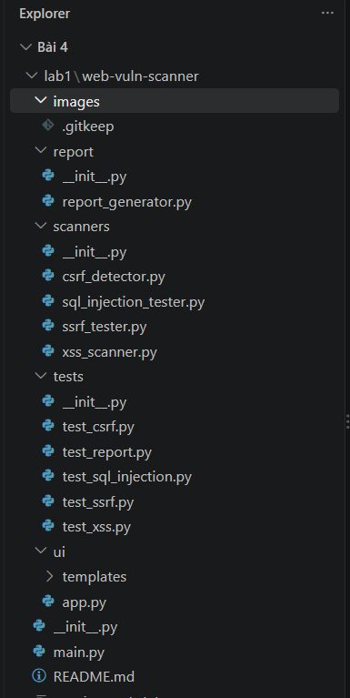
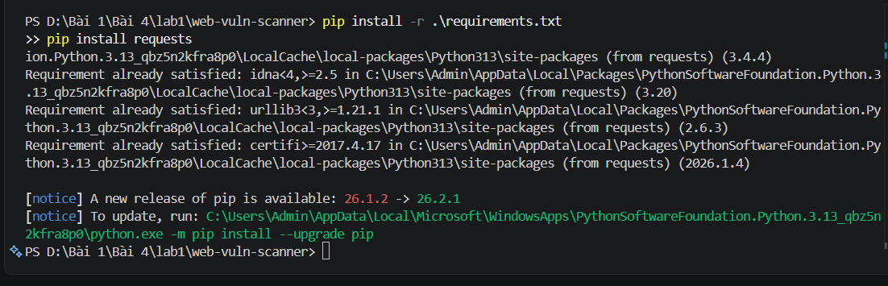
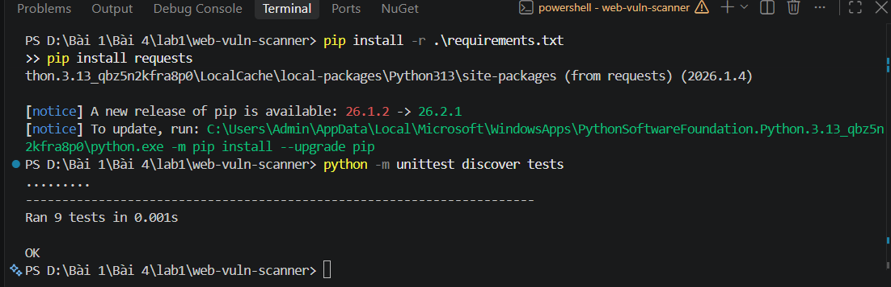
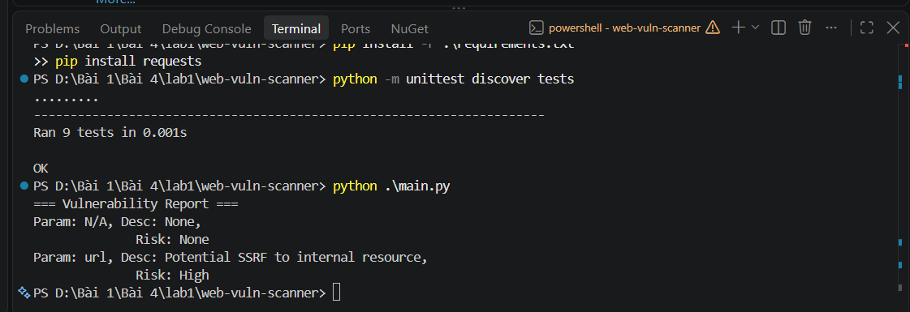
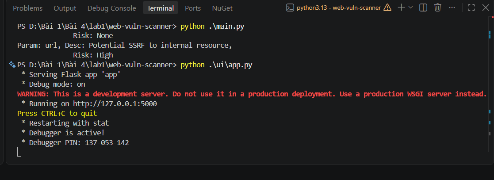
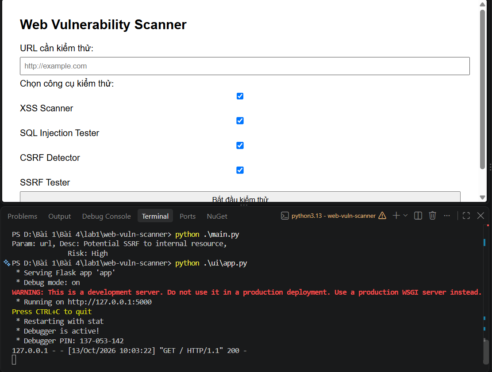
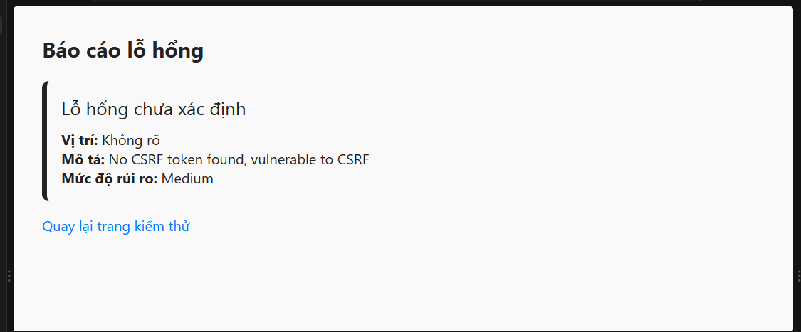
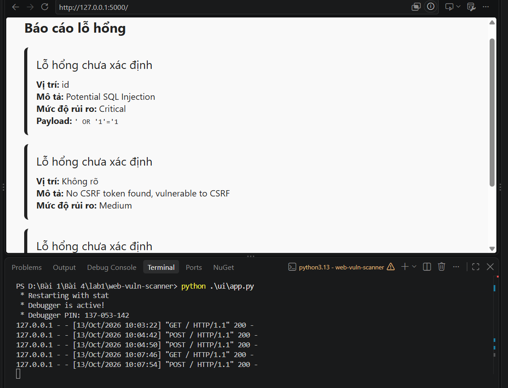

# Báo cáo Lab 1 – Tuần 4: Web Vulnerability Scanner

- Họ và tên: Võ Tự Quang Huy
- MSSV: 2387700024
- Lớp: 23DATA1
- Môn: Bảo mật mạng máy tính – Bài 4: Bảo mật Web App và API

## 1. Mục tiêu bài thực hành

Bài thực hành xây dựng một công cụ quét lỗ hổng web (Web Vulnerability Scanner) viết bằng Python, gồm 4 module kiểm tra độc lập và một module tổng hợp báo cáo:

- **XSSScanner**: phát hiện lỗ hổng Cross-Site Scripting (XSS) bằng cách gửi các payload chuẩn hóa (`<script>alert(1)</script>`, `'><svg/onload=alert(1)>`) vào tham số `q` của URL đích và kiểm tra payload có bị phản chiếu nguyên văn trong nội dung trang trả về hay không.
- **SQLInjectionTester**: kiểm tra các biến thể tấn công SQL Injection bằng cách đối chiếu giá trị các tham số có sẵn trong URL với tập payload mẫu (`' OR '1'='1`, `' UNION SELECT NULL--`, ...).
- **CSRFDetector**: phân tích nội dung HTML của một form để xác định form đó có token chống CSRF (`csrf_token`, `_csrf`, `csrfmiddlewaretoken`) hay không.
- **SSRFTester**: phát hiện lỗ hổng Server-Side Request Forgery bằng cách kiểm tra giá trị tham số URL có trỏ tới các địa chỉ nội bộ (`127.0.0.1`, `localhost`, dải `10.x`, `192.168.x`, `172.16–31.x`) hay không.
- **ReportGenerator**: gộp kết quả của 4 module trên thành một báo cáo lỗ hổng thống nhất.

Công cụ có hai cách sử dụng: chạy trực tiếp qua dòng lệnh (`main.py`) với dữ liệu mẫu dựng sẵn, hoặc chạy qua giao diện web (`ui/app.py`) để người dùng tự nhập URL cần kiểm thử.

## 2. Cấu trúc thư mục



Dự án được tổ chức theo từng vai trò rõ ràng:
- `scanners/`: chứa 4 lớp quét lỗ hổng kể trên, mỗi lớp một file riêng.
- `report/`: chứa `ReportGenerator`, chịu trách nhiệm chuẩn hóa dữ liệu từ nhiều scanner thành một cấu trúc báo cáo duy nhất.
- `tests/`: bộ kiểm thử đơn vị (unit test) cho từng scanner và cho `ReportGenerator`.
- `ui/`: ứng dụng web Flask, cung cấp giao diện nhập URL và hiển thị kết quả.
- `main.py`: điểm vào chạy thử nhanh bằng dòng lệnh, dùng dữ liệu mẫu dựng sẵn (không cần giao diện web).

## 3. Cài đặt môi trường



Dự án cần hai thư viện ngoài: `Flask` (dựng giao diện web) khai báo trong `requirements.txt`, và `requests` (dùng để `XSSScanner` gửi HTTP request thật đến trang đích) được cài bổ sung bằng `pip install requests`. Terminal xác nhận cả hai cùng các gói phụ thuộc (`idna`, `urllib3`, `certifi`) đã có sẵn trong môi trường.

## 4. Kiểm thử đơn vị (Unit Test)



Lệnh `python -m unittest discover tests` quét toàn bộ thư mục `tests/` và chạy 9 trường hợp kiểm thử tương ứng với 5 file test (`test_csrf.py`, `test_report.py`, `test_sql_injection.py`, `test_ssrf.py`, `test_xss.py`), mỗi file kiểm tra cả trường hợp có lỗ hổng lẫn trường hợp không có lỗ hổng cho từng module. Kết quả `Ran 9 tests in 0.001s` và `OK` xác nhận toàn bộ logic của 4 scanner và `ReportGenerator` hoạt động đúng như thiết kế trước khi đưa vào sử dụng thực tế.

## 5. Chạy chương trình chính (main.py)



`main.py` minh họa cách dùng công cụ bằng một URL mẫu dựng sẵn, đã nhúng sẵn payload cho nhiều loại lỗ hổng cùng lúc:
```
http://example.com/page?input=<script>alert(1)</script>&id=' OR '1'='1&url=http://127.0.0.1/admin
```
và một đoạn HTML form không có token CSRF. Kết quả in ra cho thấy `SSRFTester` phát hiện tham số `url` trỏ tới `127.0.0.1` (mức rủi ro **High**), đúng với mục đích minh họa khả năng dò lỗ hổng SSRF của công cụ.

## 6. Chạy giao diện web



Lệnh `python .\ui\app.py` khởi động ứng dụng Flask ở chế độ debug, lắng nghe tại `http://127.0.0.1:5000`. Đây là bước chuyển từ chạy thử bằng dòng lệnh sang cung cấp giao diện để người dùng tự nhập URL cần kiểm thử, phù hợp với mục tiêu xây dựng công cụ có thể sử dụng thực tế chứ không chỉ chạy với dữ liệu mẫu cố định.



Giao diện gồm một ô nhập URL cần kiểm thử và 4 ô chọn loại công cụ quét (XSS Scanner, SQL Injection Tester, CSRF Detector, SSRF Tester), mặc định cả 4 ô đều được tick sẵn để quét toàn diện.

## 7. Kết quả kiểm thử

### 7.1. Trường hợp URL không chứa payload hợp lệ



Khi kiểm thử với một URL không mang theo giá trị tham số trùng khớp với các payload mẫu của `SQLInjectionTester`/`SSRFTester`/`XSSScanner`, công cụ chỉ trả về một phát hiện duy nhất: **CSRF – mức rủi ro Medium**, với mô tả "No CSRF token found, vulnerable to CSRF". Đây là kết quả đúng với thiết kế: `CSRFDetector` trong bản demo của giao diện web luôn kiểm tra một đoạn HTML form mẫu cố định (không có token), nên luôn báo thiếu CSRF token bất kể URL nhập vào là gì; còn 3 scanner còn lại không tìm thấy gì vì URL không chứa chuỗi payload cần dò.

### 7.2. Trường hợp URL có chứa payload SQL Injection



Khi kiểm thử với URL có tham số `id` mang giá trị payload `' OR '1'='1`, `SQLInjectionTester` phát hiện và báo cáo đúng: vị trí tham số `id`, mô tả "Potential SQL Injection", mức rủi ro **Critical**, kèm theo chính payload đã khớp. Kết quả này cùng xuất hiện với phát hiện CSRF mặc định như mục 7.1, chứng minh `ReportGenerator` tổng hợp đúng kết quả từ nhiều scanner chạy đồng thời trong một lần quét.

## 8. Nhận xét

- Công cụ hoạt động đúng với mục tiêu đề ra: phát hiện được cả 4 loại lỗ hổng phổ biến (XSS, SQL Injection, CSRF, SSRF) thông qua các kỹ thuật dò chuỗi payload và request thực tế.
- Hạn chế: `SQLInjectionTester` và `SSRFTester` chỉ đối chiếu chuỗi tĩnh có sẵn trong tham số URL, không tự sinh và gửi payload tấn công thật, nên chỉ phát hiện được các trường hợp payload đã nằm sẵn trong URL kiểm thử, không mô phỏng được tấn công Blind SQLi hay Time-based SQLi như lý thuyết đã trình bày ở mục 4.1.
- `CSRFDetector` trong bản giao diện web dùng một đoạn HTML cố định làm demo, chưa thực sự lấy nội dung form từ trang web đích — đây là điểm có thể cải tiến trong các phiên bản sau.
- `XSSScanner` phụ thuộc vào khả năng truy cập mạng thật đến trang đích để kiểm tra phản chiếu payload, nên kết quả có thể thay đổi tùy tình trạng kết nối Internet tại thời điểm quét.
