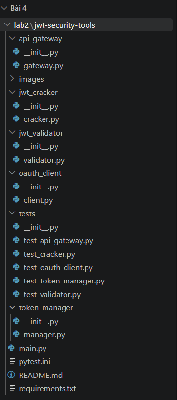
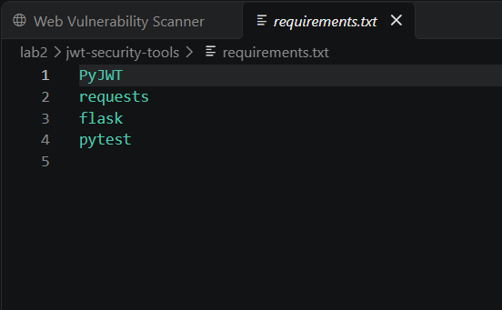
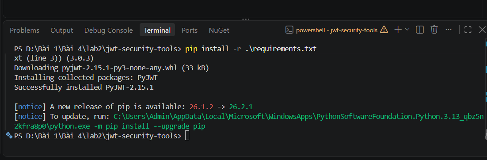
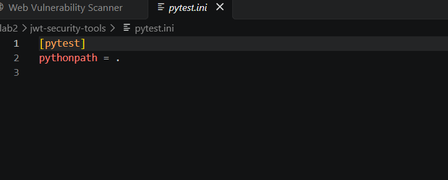
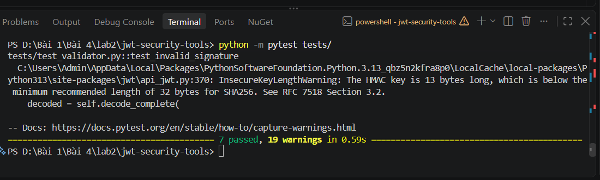
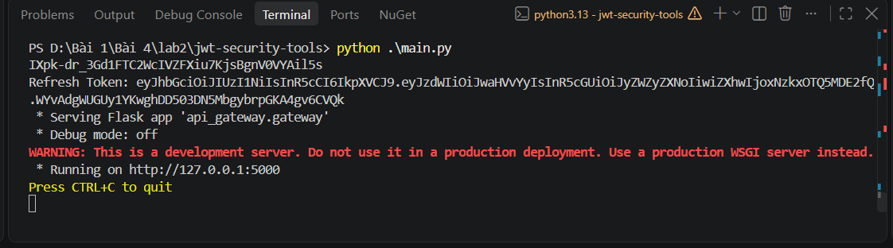
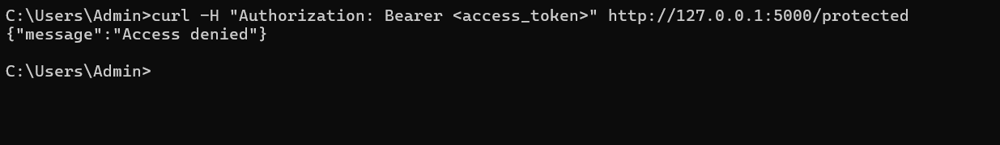
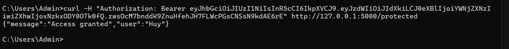

# Báo cáo Lab 2 – Tuần 4: JWT Security Tools

- Họ và tên: Võ Tự Quang Huy
- MSSV: 2387700024
- Lớp: 23DATA1
- Môn: Bảo mật mạng máy tính – Bài 4: Bảo mật Web App và API

## 1. Mục tiêu bài thực hành

Bài thực hành xây dựng một bộ công cụ bảo mật JWT (JSON Web Token) gồm 5 module, tương ứng với các khía cạnh đã học ở phần lý thuyết (cấu trúc JWT, các lỗ hổng phổ biến, luồng OAuth 2.0, vòng đời token):

- **JWTValidator**: kiểm tra toàn diện tính hợp lệ của một JWT — chữ ký đúng khóa bí mật, token chưa hết hạn (`exp`), trả về lý do cụ thể nếu token không hợp lệ.
- **JWTCracker**: mô phỏng tấn công brute-force khóa bí mật dùng để ký JWT, bằng cách thử lần lượt các mật khẩu trong một wordlist (chạy song song bằng `ThreadPoolExecutor`) — minh họa rủi ro "Brute force secret" đã nêu ở phần lý thuyết.
- **OAuthClient**: dựng URL ủy quyền (`authorization_code` flow) và đổi mã code lấy access token theo chuẩn OAuth 2.0.
- **TokenManager**: quản lý vòng đời token — phát hành cặp access token (hạn ngắn, mặc định 15 phút) và refresh token (hạn dài, mặc định 24 giờ), đồng thời cấp lại access token mới từ refresh token còn hạn.
- **APIGateway**: một cổng API Flask tối giản, bảo vệ route `/protected` bằng cách bắt buộc client gửi kèm JWT hợp lệ trong header `Authorization: Bearer <token>`.

`main.py` liên kết `TokenManager` và `APIGateway` lại với nhau: phát hành một cặp token cho người dùng, in ra terminal, rồi khởi động API Gateway để có thể gọi thử bằng `curl`.

## 2. Cấu trúc thư mục

Mỗi module trong mục 1 được tách thành một package riêng (`api_gateway/`, `jwt_cracker/`, `jwt_validator/`, `oauth_client/`, `token_manager/`), đi kèm một file test tương ứng trong `tests/`. Cách tổ chức này cho phép kiểm thử độc lập từng thành phần bảo mật trước khi ráp chúng lại trong `main.py`.

## 3. Cài đặt môi trường

`requirements.txt` khai báo 4 thư viện: `PyJWT` (mã hóa/giải mã JWT), `requests` (gửi HTTP request cho `OAuthClient`), `flask` (dựng `APIGateway`), `pytest` (chạy bộ kiểm thử).

Lệnh `pip install -r .\requirements.txt` cài đặt `PyJWT` thành công (`Successfully installed PyJWT-2.15.1`); các thư viện còn lại đã có sẵn trong môi trường từ trước.

## 4. Cấu hình pytest

`pytest.ini` khai báo `pythonpath = .`, nghĩa là khi chạy pytest từ thư mục gốc dự án, Python sẽ coi thư mục hiện tại là gốc để tìm module — nhờ vậy các file test trong `tests/` mới `import` được trực tiếp các package như `token_manager.manager`, `api_gateway.gateway` mà không cần cài đặt dự án như một package chính thức.

## 5. Kiểm thử đơn vị (pytest)

Lệnh `python -m pytest tests/` chạy 7 trường hợp kiểm thử (ứng với 5 file: `test_api_gateway.py`, `test_cracker.py`, `test_oauth_client.py`, `test_token_manager.py`, `test_validator.py`), kết quả **7 passed**. Terminal cũng hiện cảnh báo `InsecureKeyLengthWarning: The HMAC key is 13 bytes long, which is below the minimum recommended length of 32 bytes for SHA256` — đây là lời nhắc từ chính thư viện `PyJWT`, xuất phát từ việc các khóa bí mật dùng trong test (ví dụ `"mysecret"`, `"key123"`) quá ngắn. Cảnh báo này minh họa trực tiếp cho rủi ro "Brute force secret" đã nêu ở phần lý thuyết: khóa càng ngắn thì `JWTCracker` càng dễ dò ra bằng wordlist.

## 6. Chạy chương trình chính (main.py)

`python .\main.py` gọi `TokenManager.generate_tokens("huy")` để phát hành một cặp Access Token / Refresh Token cho người dùng, in ra terminal, sau đó khởi động `APIGateway` (thực chất là một Flask app tên `api_gateway.gateway`, chạy ở chế độ `Debug mode: off` vì `gateway.run()` không bật `debug=True`) tại `http://127.0.0.1:5000`. Access Token này sẽ được dùng để gọi thử endpoint `/protected` ở bước tiếp theo.

## 7. Kiểm tra xác thực bằng curl

Khi gửi request với giá trị `<access_token>` còn nguyên dấu ngoặc nhọn (tức là chưa dán token thật vào), `APIGateway` thử giải mã chuỗi này như một JWT và thất bại ngay từ bước kiểm tra chữ ký/định dạng, nên trả về `{"message":"Access denied"}`. Kết quả này cho thấy `jwt.decode()` trong `protected()` hoạt động đúng: từ chối mọi chuỗi không phải JWT hợp lệ, kể cả khi không có logic kiểm tra định dạng tường minh nào khác trong code.

Khi dán đúng Access Token vừa được `main.py` phát hành, `APIGateway` giải mã JWT thành công bằng cùng khóa bí mật đã dùng để ký, xác nhận chữ ký hợp lệ và token chưa hết hạn, trả về `{"message":"Access granted","user":"Huy"}` — đúng với giá trị `sub` đã nhúng trong token ở bước 6. Kết quả này chứng minh toàn bộ luồng cấp phát và xác thực JWT của `TokenManager` và `APIGateway` hoạt động đúng với nhau.

## 8. Nhận xét

- Cả 5 module hoạt động đúng với mục tiêu đề ra, 7/7 test case pass, luồng cấp token – gọi API – xác thực token diễn ra đúng như lý thuyết JWT đã trình bày.
- Cảnh báo `InsecureKeyLengthWarning` khi chạy pytest là một quan sát bảo mật thực tế đáng chú ý: các khóa bí mật dùng trong `tests/` và `main.py` (`"mysecret"`, `"key123"`, `"supersecret"`...) đều ngắn hơn khuyến nghị 32 byte cho HS256, khiến chúng dễ bị `JWTCracker` dò ra bằng brute-force — đúng với rủi ro "Brute force secret" đã học ở mục 4.3.1.
- Access Token mặc định chỉ sống 15 phút (`access_exp=15` trong `TokenManager`), nên khi thao tác thực hành cần copy và dán token ngay sau khi `main.py` in ra, tránh trường hợp token hết hạn trước khi kịp gọi `curl`.
