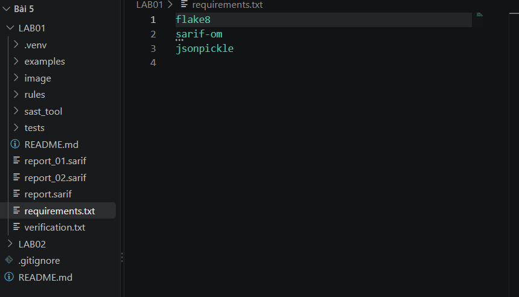
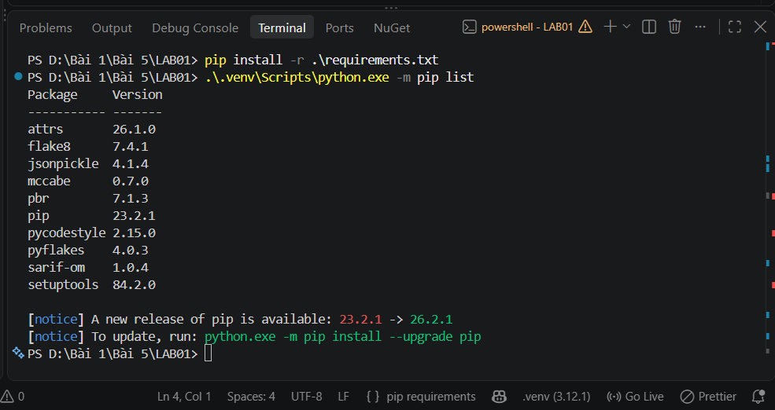
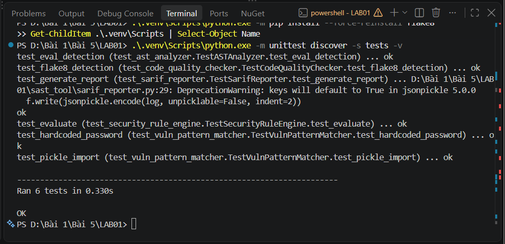
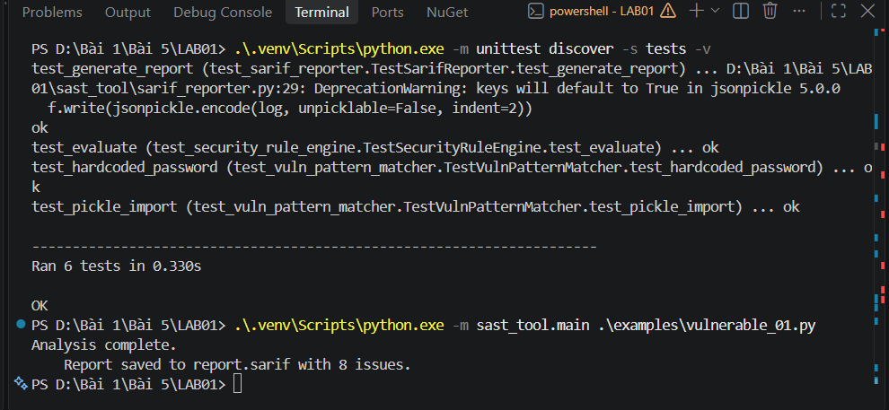
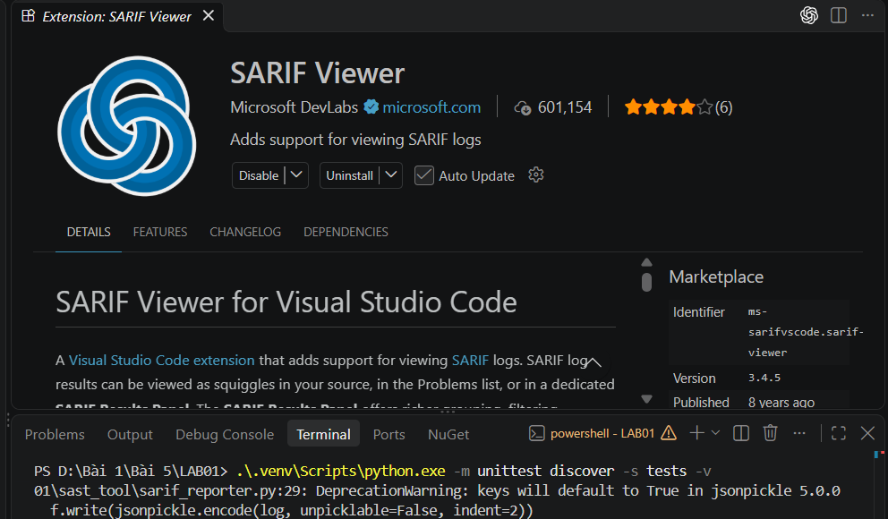
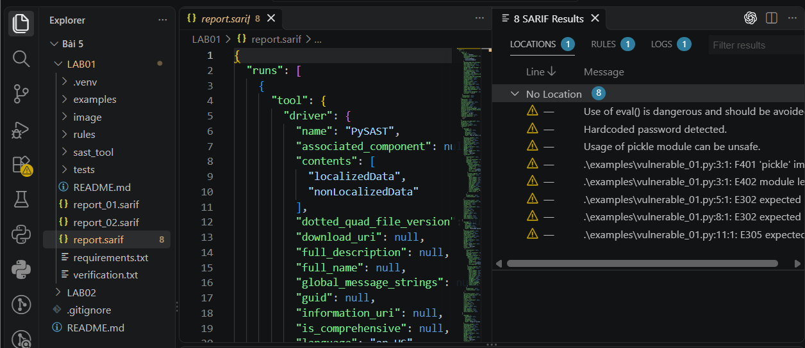
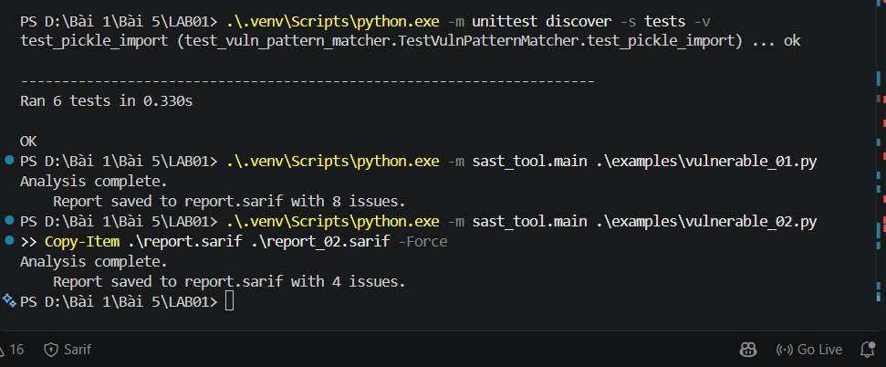
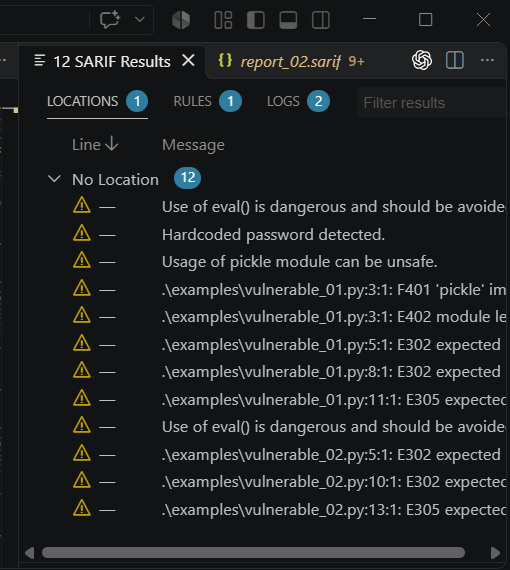

- Họ và tên: Võ Tự Quang Huy
- MSSV: 2387700024
- Lớp: 23DATA1

# BÁO CÁO THỰC HÀNH BÀI 5 – LAB01: PHÂN TÍCH BẢO MẬT TĨNH (SAST-TOOL)

## 1. Giới thiệu

Kiểm thử bảo mật tĩnh (Static Application Security Testing – SAST) là nhóm kỹ thuật khảo sát mã nguồn mà không cần thực thi chương trình. Nhờ đó, các mẫu mã nguy hiểm như gọi `eval`, mật khẩu viết cứng hay nạp module không an toàn có thể được phát hiện từ giai đoạn viết mã, trước khi phần mềm được triển khai. Bài thực hành này xây dựng một công cụ SAST thu nhỏ cho mã nguồn Python, kết hợp ba hướng tiếp cận: phân tích cây cú pháp trừu tượng (AST), đối sánh mẫu bằng biểu thức chính quy và kiểm tra quy cách mã bằng flake8. Kết quả được xuất ra định dạng SARIF (Static Analysis Results Interchange Format), một chuẩn trao đổi kết quả phân tích tĩnh giữa các công cụ.

## 2. Kiến trúc công cụ

Công cụ được tổ chức thành package `sast_tool` gồm năm thành phần, mỗi thành phần đảm nhiệm một khâu trong quy trình phân tích.

| Thành phần | Tệp | Vai trò |
|---|---|---|
| ASTAnalyzer | `ast_analyzer.py` | Duyệt cây AST do thư viện `ast` sinh ra và ghi nhận các lời gọi hàm `eval` cùng vị trí dòng, cột |
| VulnPatternMatcher | `vuln_pattern_matcher.py` | Dùng biểu thức chính quy tìm mật khẩu viết cứng và câu lệnh `import pickle` |
| SecurityRuleEngine | `security_rule_engine.py` | Đọc `rules/default_rules.json` và gán mức độ nghiêm trọng (severity) cho từng phát hiện theo loại |
| CodeQualityChecker | `code_quality_checker.py` | Gọi flake8 qua `subprocess`, tách kết quả thành các cảnh báo lint có số dòng và số cột |
| SarifReporter | `sarif_reporter.py` | Chuyển danh sách phát hiện thành đối tượng SARIF bằng `sarif-om`, rồi ghi ra tệp `report.sarif` bằng `jsonpickle` |

Tệp `main.py` điều phối toàn bộ chuỗi xử lý: đọc mã nguồn cần phân tích, chạy ba bộ phát hiện, đưa kết quả AST và đối sánh mẫu qua bộ luật, cộng thêm cảnh báo lint, rồi giao cho SarifReporter xuất báo cáo. Hai tệp mẫu `examples/vulnerable_01.py` và `examples/vulnerable_02.py` chứa các lỗi có chủ đích để làm đối tượng kiểm thử.

## 3. Quá trình thực hiện

### 3.1. Chuẩn bị cấu trúc dự án và môi trường

Thư mục `LAB01` được tổ chức gồm `examples`, `rules`, `sast_tool`, `tests`, `image` và tệp `requirements.txt`. Tệp này khai báo ba thư viện cần thiết là `flake8`, `sarif-om` và `jsonpickle`.

*Hình 1. Cấu trúc thư mục LAB01 và nội dung `requirements.txt`.*

Các thư viện được cài vào môi trường ảo `.venv` riêng của bài (Python 3.12.1) nhằm tránh xung đột với các gói đã có trên máy. Danh sách gói sau khi cài cho thấy flake8 7.4.1, jsonpickle 4.1.4 và sarif-om 1.0.4, kèm các gói phụ thuộc như pycodestyle, pyflakes, mccabe, attrs và pbr.

*Hình 2. Danh sách thư viện trong môi trường ảo sau khi cài đặt.*

### 3.2. Kiểm thử đơn vị

Bộ kiểm thử gồm sáu test case phân bố trên năm tệp, bao phủ cả năm thành phần của công cụ: nhận diện `eval`, nhận diện mật khẩu viết cứng và `import pickle`, gán severity theo luật, chạy flake8 trên tệp tạm và sinh tệp SARIF. Cả sáu test đều đạt, chương trình báo `Ran 6 tests` và `OK`. Dòng cảnh báo `DeprecationWarning` của jsonpickle về giá trị mặc định của tham số `keys` trong phiên bản 5.0.0 chỉ mang tính thông báo, không làm test thất bại.

*Hình 3. Kết quả chạy unit test: 6 test đạt.*

Trong lần chạy đầu, `test_flake8_detection` báo lỗi `FileNotFoundError` vì tệp thực thi `flake8.exe` không có trong thư mục `.venv\Scripts`, trong khi `CodeQualityChecker` gọi lệnh `flake8` trực tiếp qua `subprocess`. Sau khi cài lại flake8 bằng `pip install --force-reinstall flake8` và đưa thư mục `Scripts` của môi trường ảo vào biến `PATH` của phiên terminal, test này đạt như Hình 3.

### 3.3. Phân tích tệp `vulnerable_01.py`

Tệp `vulnerable_01.py` chứa mật khẩu viết cứng `password = "123456"`, câu lệnh `import pickle` và hàm `unsafe_func` gọi `eval(data)`. Công cụ được chạy trên tệp này thông qua `python -m sast_tool.main` và ghi nhận 8 vấn đề vào `report.sarif`.

*Hình 4. Kết quả phân tích `vulnerable_01.py`: 8 vấn đề.*

Tám phát hiện được chia thành ba nhóm theo nguồn sinh ra:

| STT | Dòng | Nội dung | Nguồn |
|---|---|---|---|
| 1 | 6 | Sử dụng `eval()` nguy hiểm | ASTAnalyzer |
| 2 | 1 | Phát hiện mật khẩu viết cứng | VulnPatternMatcher |
| 3 | 3 | Module `pickle` có thể không an toàn | VulnPatternMatcher |
| 4 | 3 | F401: `pickle` được import nhưng không dùng | flake8 |
| 5 | 3 | E402: import không nằm ở đầu tệp | flake8 |
| 6 | 5 | E302: cần 2 dòng trống, thực tế có 1 | flake8 |
| 7 | 8 | E302: cần 2 dòng trống, thực tế có 1 | flake8 |
| 8 | 11 | E305: cần 2 dòng trống sau khai báo hàm, thực tế có 1 | flake8 |

### 3.4. Xem báo cáo SARIF trong Visual Studio Code

Để đọc báo cáo dưới dạng bảng thay vì JSON thô, extension SARIF Viewer của Microsoft DevLabs được cài vào Visual Studio Code.

*Hình 5. Extension SARIF Viewer (Microsoft DevLabs) đã được cài đặt.*

Khi mở `report.sarif`, panel **SARIF Results** hiển thị đủ 8 kết quả khớp với số liệu ở Hình 4, theo đúng thứ tự: cảnh báo `eval`, hai cảnh báo từ đối sánh mẫu, rồi năm cảnh báo lint. Tệp JSON bên trái cho thấy cấu trúc báo cáo với công cụ `PySAST` ở phần `tool.driver`.

*Hình 6. Panel SARIF Results hiển thị 8 kết quả của `vulnerable_01.py`.*

### 3.5. Phân tích tệp `vulnerable_02.py`

Tệp thứ hai gồm hàm `dangerous_eval` gọi `eval(user_input)`, hàm `read_file` đọc tệp và hàm `execute_code` gọi `exec(code)`. Công cụ trả về 4 vấn đề.

*Hình 7. Kết quả phân tích `vulnerable_02.py`: 4 vấn đề.*

| STT | Dòng | Nội dung | Nguồn |
|---|---|---|---|
| 1 | 3 | Sử dụng `eval()` nguy hiểm | ASTAnalyzer |
| 2 | 5 | E302: cần 2 dòng trống, thực tế có 1 | flake8 |
| 3 | 10 | E302: cần 2 dòng trống, thực tế có 1 | flake8 |
| 4 | 13 | E305: cần 2 dòng trống sau khai báo hàm, thực tế có 1 | flake8 |

Tệp này không chứa mật khẩu viết cứng hay `import pickle` nên không có cảnh báo từ đối sánh mẫu. Lời gọi `exec(code)` ở dòng 11 không được báo cáo, vì ASTAnalyzer chỉ có quy tắc cho tên hàm `eval`.

### 3.6. Đối chiếu hai báo cáo

Khi cả hai tệp `report_01.sarif` và `report_02.sarif` cùng được mở, SARIF Viewer gộp chung thành 12 kết quả, bằng tổng 8 và 4 ở trên. Các dòng của hai tệp xuất hiện lần lượt trong cùng một danh sách, trong đó cảnh báo `eval` xuất hiện ở cả hai tệp.

*Hình 8. SARIF Viewer hiển thị 12 kết quả khi mở đồng thời hai báo cáo.*

## 4. Đánh giá và nhận xét

**Hiệu quả phát hiện.** Công cụ nhận diện đúng các lỗi có chủ đích trong hai tệp mẫu: `eval` ở cả hai tệp, mật khẩu viết cứng và `pickle` ở tệp thứ nhất. Việc kết hợp AST với đối sánh mẫu cho thấy sự khác biệt giữa hai hướng: AST xác định chính xác lời gọi hàm theo cấu trúc cú pháp, còn biểu thức chính quy phù hợp với các chuỗi văn bản như mật khẩu hay câu lệnh import.

**Giới hạn của bộ phát hiện.**
- ASTAnalyzer chỉ kiểm tra tên hàm `eval`, nên `exec` ở `vulnerable_02.py` không bị cảnh báo dù có mức nguy hiểm tương đương.
- Biểu thức chính quy cho mật khẩu chỉ khớp chuỗi đặt trong dấu nháy kép và tên biến đúng là `password`. Các cách viết khác như dấu nháy đơn hay tên biến `pwd` sẽ bị bỏ sót.
- `test_flake8_detection` chấp nhận cả trường hợp không có kết quả nào, nên việc test này đạt không chứng minh flake8 phát hiện đầy đủ. Số lượng cảnh báo thực tế phải được xác nhận qua lần chạy trên hai tệp mẫu.

**Mức độ nghiêm trọng.** Tệp `default_rules.json` gán `high` cho `eval`, `medium` cho đối sánh mẫu và `low` cho lint. Tuy nhiên, cảnh báo lint được cộng thêm sau bước `evaluate` nên không đi qua bộ luật, và `SarifReporter` không ghi severity vào đối tượng kết quả. Vì vậy, trong SARIF Viewer, mọi phát hiện đều hiển thị cùng một biểu tượng cảnh báo, không phân biệt `eval` với lỗi định dạng.

**Chất lượng báo cáo SARIF.** Panel kết quả nhóm cả 8 mục vào **No Location** và cột dòng hiển thị dấu gạch ngang, dù tệp JSON vẫn chứa số dòng và số cột. Nhiều khả năng nguyên nhân nằm ở cách `jsonpickle` tuần tự hóa đối tượng `sarif-om`, khiến tên trường trong JSON dùng dạng `physical_location`, `start_line`, `schema_uri` thay vì dạng camelCase của đặc tả SARIF 2.1.0. Điều này cho thấy báo cáo đọc được nhưng chưa tuân thủ đầy đủ chuẩn trao đổi.

## 5. Kết luận

Bài thực hành đã hoàn thành đầy đủ chuỗi công việc: dựng công cụ SAST gồm năm thành phần, xác minh bằng sáu unit test đạt, phân tích hai tệp mẫu với kết quả lần lượt là 8 và 4 vấn đề, và xuất báo cáo SARIF xem được trong Visual Studio Code. Qua đó, em hiểu rõ cách AST và đối sánh mẫu hỗ trợ phát hiện lỗ hổng từ mã nguồn, vai trò của bộ luật trong việc phân loại mức độ rủi ro, và những hạn chế khi một công cụ chỉ dựa trên tập quy tắc cố định: dễ bỏ sót các biến thể như `exec`, và khó bảo đảm tính chuẩn hóa của báo cáo đầu ra. Các hạn chế này gợi ý hướng mở rộng gồm bổ sung quy tắc AST cho các hàm nguy hiểm khác, truyền severity vào báo cáo và chuẩn hóa tên trường theo đặc tả SARIF.
