- Họ và tên: Võ Tự Quang Huy
- MSSV: 2387700024
- Lớp: 23DATA1

---

# BÁO CÁO THỰC HÀNH LAB 02
## PHÂN TÍCH VÀ KIỂM THỬ BẢO MẬT ĐỘNG (DYNAMIC ANALYSIS SECURITY TESTING – DAST)

---

## 1. Mục tiêu

Bài thực hành xây dựng một nền tảng phân tích động (*Dynamic Analysis Platform*) bằng Python, cho phép quan sát hành vi của một tiến trình trong lúc nó đang thực thi. Sau khi hoàn thành, sinh viên nắm được:

- Bản chất của kiểm thử bảo mật thời gian chạy (*Runtime Security Testing – RST*) và điểm khác biệt so với phân tích tĩnh (SAST).
- Cách thu thập các chỉ số hành vi của tiến trình: CPU, bộ nhớ, tệp đang mở, lưu lượng mạng.
- Nguyên lý phát hiện rò rỉ bộ nhớ, tràn số nguyên và các lời gọi hàm nguy hiểm (`os.system`, `eval`, `exec`).
- Nguyên lý của môi trường cách ly (*sandbox*) khi thực thi lệnh không tin cậy.
- Cách đóng gói các chức năng giám sát thành dịch vụ REST API bằng Flask và kiểm thử bằng unit test.

## 2. Cơ sở lý thuyết

### 2.1. Runtime Security Testing (RST)

RST là quá trình theo dõi và phân tích hành vi của phần mềm khi đang chạy nhằm phát hiện hoạt động nguy hiểm, lỗ hổng tiềm ẩn hoặc hành vi bất thường. Khác với phân tích tĩnh vốn làm việc trên mã nguồn, RST phát hiện được các lỗi chỉ xuất hiện trong môi trường thực thi như tấn công injection (SQLi, RCE, command injection), race condition hoặc trạng thái không an toàn.

Nền tảng RST trong bài gồm năm thành phần:

| Thành phần | Chức năng |
|---|---|
| `RuntimeMonitor` | Ghi nhận hành vi của tiến trình: CPU, bộ nhớ, tệp đang mở |
| `MemoryAnalyzer` | Phát hiện rò rỉ bộ nhớ và tràn số cơ bản |
| `NetworkTrafficAnalyzer` | Thống kê lưu lượng mạng theo từng giao diện |
| `SecurityBehaviorChecker` | Nhận diện các lời gọi hàm nghi ngờ theo luật |
| `VirtualSandbox` | Thực thi lệnh trong thư mục tạm tách biệt |

### 2.2. Phân tích hành vi (Behavioral Analysis)

Phân tích hành vi đánh giá những gì một chương trình thực sự làm trong quá trình chạy, không dựa vào chữ ký mẫu đã biết. Các kỹ thuật phổ biến gồm *rule-based detection*, *heuristic analysis*, *anomaly detection* và phát hiện dựa trên học máy. Bài thực hành áp dụng cách tiếp cận rule-based: đối chiếu hành vi với danh sách lời gọi hàm nguy hiểm định nghĩa trước.

### 2.3. Phân tích trong môi trường hộp cát (Sandbox)

Sandbox chạy phần mềm chưa rõ nguồn gốc trong môi trường cô lập để quan sát hành vi mà không ảnh hưởng hệ thống thật. Các loại phổ biến: dựa trên máy ảo (VM-based), dựa trên container, bare-metal và in-memory/emulator. Mức độ cô lập càng cao thì độ an toàn càng lớn, đổi lại chi phí tài nguyên càng nhiều.

## 3. Môi trường thực hiện

| Hạng mục | Chi tiết |
|---|---|
| Hệ điều hành | Windows (PowerShell) |
| Trình soạn thảo | Visual Studio Code |
| Ngôn ngữ | Python 3.12.1, chạy trong môi trường ảo `.venv` |
| Thư viện | `psutil` 7.2.2, `Flask` 3.1.3 (kèm Werkzeug 3.1.9, Jinja2 3.1.6, click 8.5.0, itsdangerous 2.2.0, MarkupSafe 3.0.4, blinker 1.9.0) |
| Kiểm thử | `unittest` |

## 4. Cấu trúc

```
LAB02/
├── image/                        # ảnh minh chứng
├── tests/                        # unit test
│   ├── test_memory_analyzer.py
│   ├── test_network_traffic_analyzer.py
│   ├── test_runtime_monitor.py
│   ├── test_security_behavior_checker.py
│   └── test_virtual_sandbox.py
├── __init__.py
├── app.py                        # dịch vụ REST API (Flask)
├── main.py                       # chạy toàn bộ các bộ phân tích
├── memory_analyzer.py
├── network_traffic_analyzer.py
├── runtime_monitor.py
├── security_behavior_checker.py
├── virtual_sandbox.py
├── requirements.txt
└── README.md
```

Tệp `requirements.txt` khai báo hai phụ thuộc của dự án: `psutil` và `Flask`.

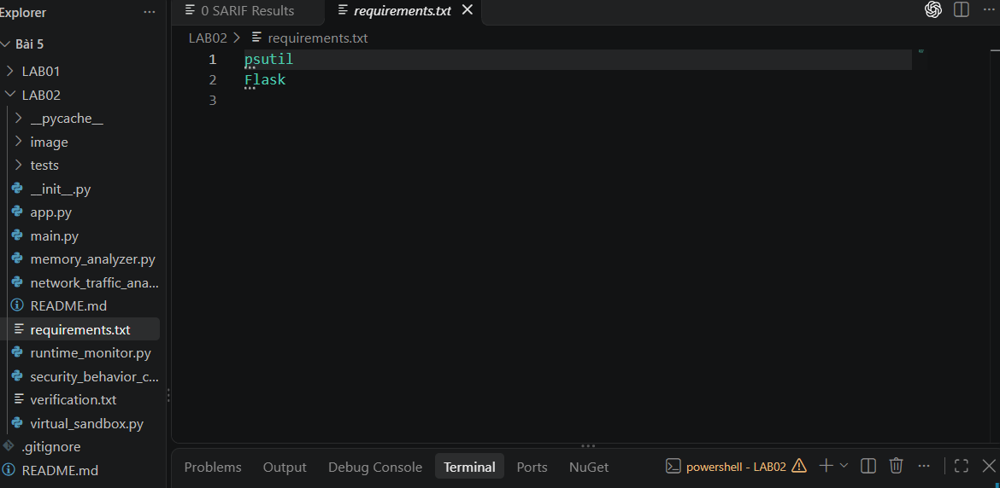

*Hình 1. Tệp `requirements.txt` và cấu trúc thư mục dự án.*

## 5. Triển khai các thành phần

### 5.1. RuntimeMonitor – giám sát tiến trình

Lớp nhận PID của tiến trình cần theo dõi và dùng `psutil.Process` để truy vấn ba chỉ số: phần trăm CPU (lấy mẫu trong 1 giây), bộ nhớ vật lý đang dùng (RSS, tính bằng byte) và danh sách tệp tiến trình đang mở.

```python
class RuntimeMonitor:
    def __init__(self, pid):
        self.pid = pid
        self.process = psutil.Process(pid)

    def get_cpu_usage(self):
        return self.process.cpu_percent(interval=1.0)

    def get_memory_usage(self):
        return self.process.memory_info().rss

    def get_open_files(self):
        return self.process.open_files()
```

### 5.2. MemoryAnalyzer – rò rỉ bộ nhớ và tràn số

- `check_memory_leaks()` gọi bộ thu gom rác `gc.collect()` rồi lấy các đối tượng còn nằm trong `gc.garbage` có định nghĩa phương thức `__del__`. Đây là các đối tượng thuộc chu trình tham chiếu mà bộ thu gom không giải phóng được, nên là dấu hiệu rò rỉ.
- `check_overflow(value)` trả về `True` khi giá trị là số nguyên có trị tuyệt đối vượt `2**63`, mô phỏng tràn kiểu số nguyên có dấu 64 bit.

```python
def check_memory_leaks(self):
    gc.collect()
    return [obj for obj in gc.garbage if hasattr(obj, '__del__')]

def check_overflow(self, value):
    try:
        if isinstance(value, int) and abs(value) > 2**63:
            return True
    except:
        return False
    return False
```

### 5.3. NetworkTrafficAnalyzer – thống kê lưu lượng mạng

Dùng `psutil.net_io_counters(pernic=True)` để lấy bộ đếm theo từng giao diện mạng: số byte và gói tin gửi/nhận, số lỗi (`errin`, `errout`) và số gói bị loại (`dropin`, `dropout`). Các bộ đếm này cộng dồn từ lúc hệ thống khởi động.

```python
class NetworkTrafficAnalyzer:
    def get_network_stats(self):
        return psutil.net_io_counters(pernic=True)
```

### 5.4. SecurityBehaviorChecker – phát hiện lời gọi nguy hiểm

Lớp đọc nội dung mã nguồn và đối chiếu với danh sách `os.system`, `eval`, `exec`. Hàm nào xuất hiện trong nội dung sẽ được ghi vào danh sách cảnh báo trả về.

```python
def suspicious_calls(self):
    suspicious = []
    syscalls = ["os.system", "eval", "exec"]
    try:
        with open(__file__, 'r') as f:
            content = f.read()
            for call in syscalls:
                if call in content:
                    suspicious.append(call)
    except:
        pass
    return suspicious
```

### 5.5. VirtualSandbox – thực thi cách ly

Mỗi đối tượng tạo một thư mục tạm bằng `tempfile.mkdtemp()`. Lệnh được chạy bằng `subprocess.run` với thư mục làm việc đặt vào thư mục tạm đó, đồng thời bắt riêng `stdout` và `stderr` để trả về cho bên gọi.

```python
class VirtualSandbox:
    def __init__(self):
        self.temp_dir = tempfile.mkdtemp()

    def run_isolated(self, command):
        result = subprocess.run(command, cwd=self.temp_dir,
                                capture_output=True, shell=True)
        return result.stdout.decode(), result.stderr.decode()
```

### 5.6. Dịch vụ REST API (`app.py`)

Flask công khai các chức năng trên qua bốn endpoint `GET` và một endpoint `POST`:

| Endpoint | Phương thức | Dữ liệu trả về |
|---|---|---|
| `/api/monitor` | GET | `cpu_usage`, `memory_usage`, `open_files` |
| `/api/memory` | GET | `memory_leaks`, `overflow_test` |
| `/api/network` | GET | `network_stats` theo từng giao diện |
| `/api/security` | GET | `suspicious_calls` |
| `/api/sandbox` | POST | `stdout`, `stderr` của lệnh truyền vào qua trường `command` |

## 6. Cài đặt môi trường và thư viện

Các thư viện được cài vào môi trường ảo `.venv` bằng `pip` từ tệp `requirements.txt`. Kết quả cài đặt thành công `Flask-3.1.3`, `psutil-7.2.2` cùng các gói phụ thuộc. Pip chỉ đưa ra thông báo có bản mới hơn, không ảnh hưởng đến kết quả.

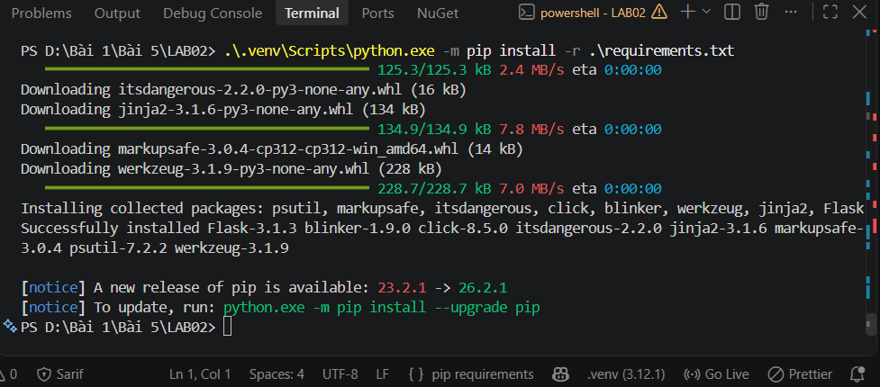

*Hình 2. Cài đặt thư viện từ `requirements.txt` trong môi trường ảo.*

## 7. Kiểm thử đơn vị

Mỗi thành phần có một bộ kiểm thử riêng trong thư mục `tests/`:

| Test | Thành phần | Điều kiện kiểm tra | Kết quả |
|---|---|---|---|
| `test_check_overflow` | MemoryAnalyzer | `2**64` trả về `True`, `100` trả về `False` | ok |
| `test_get_network_stats` | NetworkTrafficAnalyzer | Kết quả là kiểu `dict` | ok |
| `test_cpu_and_memory` | RuntimeMonitor | CPU là `float`, bộ nhớ ≥ 0 | ok |
| `test_suspicious_calls` | SecurityBehaviorChecker | Kết quả là kiểu `list` | ok |
| `test_run_isolated` | VirtualSandbox | `stdout` chứa `test`, `stderr` rỗng | ok |

Cả 5 test đều đạt, tổng thời gian 1.056 giây.

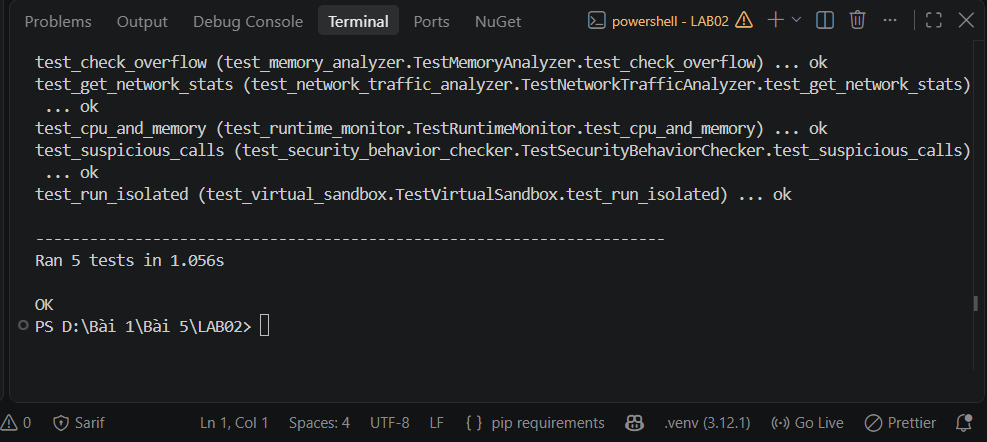

*Hình 3. Kết quả chạy unit test: 5 test, trạng thái OK.*

## 8. Kết quả chạy chương trình

### 8.1. Chạy trực tiếp `main.py`

Chương trình lần lượt giám sát chính tiến trình đang chạy, kiểm tra bộ nhớ, đọc thống kê mạng, kiểm tra lời gọi nghi ngờ và chạy lệnh `echo Hello Sandbox` trong sandbox. Phần cuối kết quả ghi nhận:

- Thống kê mạng của từng giao diện (VMware VMnet1, VMnet8, VMnet2, Wi-Fi, Bluetooth Network Connection, Loopback Pseudo-Interface 1). Giao diện Wi-Fi là nơi có lưu lượng thực tế (`bytes_recv` ≈ 15,2 tỷ, `bytes_sent` ≈ 322 triệu), các giao diện ảo hầu như không có lưu lượng.
- `Suspicious Calls: ['os.system', 'eval', 'exec']`.
- `Sandbox stdout: Hello Sandbox`, `Sandbox stderr` rỗng, nghĩa là lệnh chạy thành công, không phát sinh lỗi.

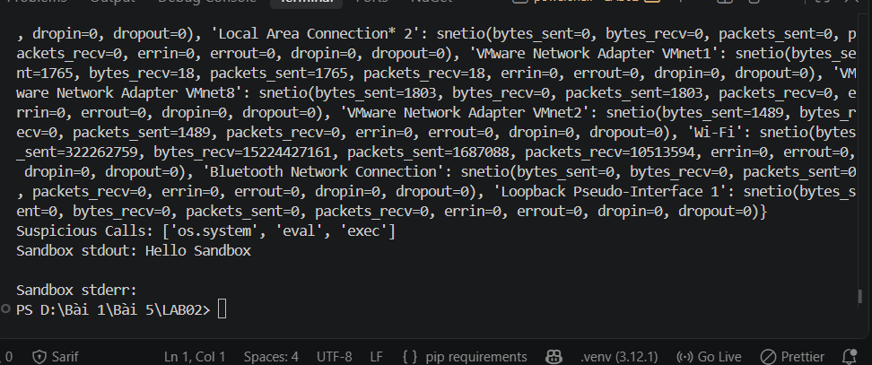

*Hình 4. Kết quả chạy `main.py` (phần cuối đầu ra).*

### 8.2. Chạy dịch vụ Flask

Chạy `app.py` khởi động máy chủ phát triển Flask tại `http://127.0.0.1:5000`, chế độ debug tắt. Cảnh báo của Flask cho biết đây là máy chủ phát triển, không dùng cho môi trường sản xuất.

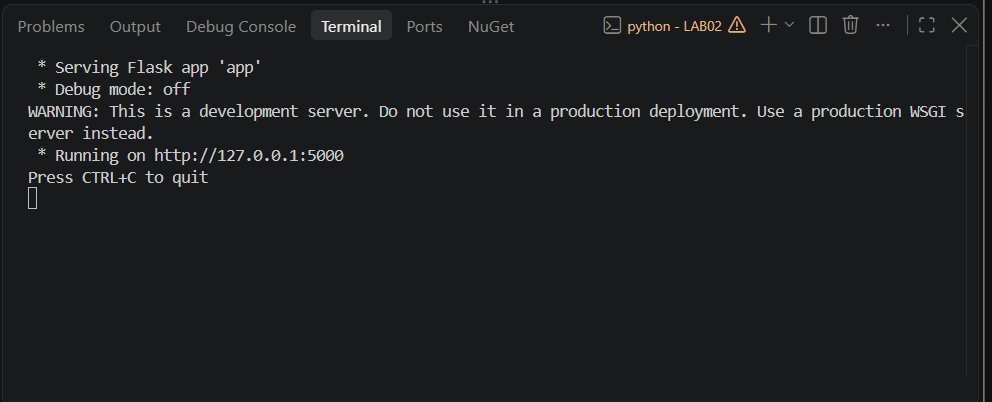

*Hình 5. Dịch vụ Flask khởi động tại `127.0.0.1:5000`.*

### 8.3. Kiểm tra các API

Các endpoint được gọi từ một cửa sổ PowerShell khác bằng `Invoke-RestMethod` và hiển thị bằng `ConvertTo-Json -Depth 8`.

**a) `GET /api/monitor`.** Tiến trình Flask có CPU 0.0%, bộ nhớ RSS 37.650.432 byte (khoảng 35,9 MB) và đang mở tệp `C:\Windows\System32\en-US\KernelBase.dll.mui`.

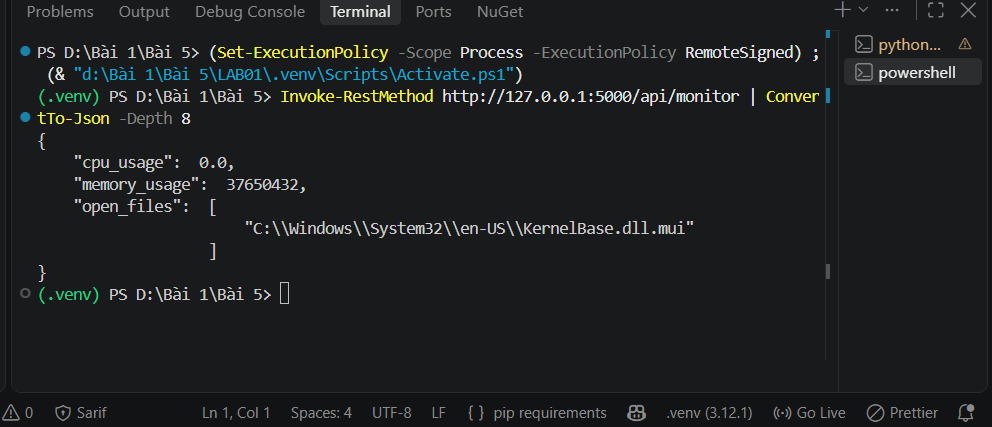

*Hình 6. Kết quả `/api/monitor`.*

**b) `GET /api/memory`.** `memory_leaks` là danh sách rỗng, tức không phát hiện đối tượng rò rỉ; `overflow_test` là `true` vì giá trị thử `2**64` vượt ngưỡng `2**63`.

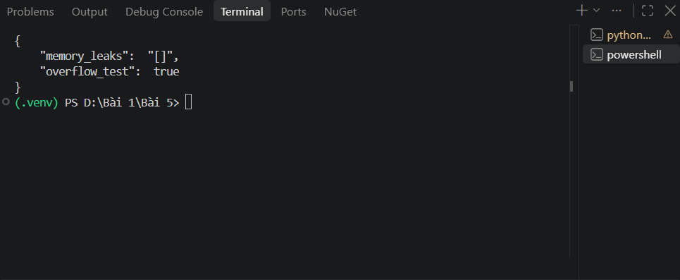

*Hình 7. Kết quả `/api/memory`.*

**c) `GET /api/network`.** Trả về bộ đếm của từng giao diện mạng dưới dạng JSON. Các giao diện Bluetooth, Ethernet và Local Area Connection đều bằng 0; VMware Network Adapter VMnet8 có 1.814 byte/gói gửi đi; giao diện Wi-Fi có lưu lượng lớn nhất (nhận 15.224.990.627 byte, gửi 323.117.487 byte, không có lỗi hay gói bị loại); giao diện vEthernet (WSL) cũng có lưu lượng đáng kể. Tất cả giá trị `errin`, `errout`, `dropin`, `dropout` đều bằng 0, cho thấy mạng hoạt động ổn định.

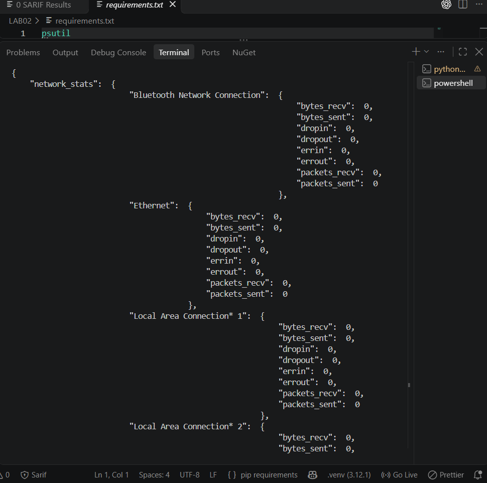

*Hình 8. Kết quả `/api/network` (phần đầu).*

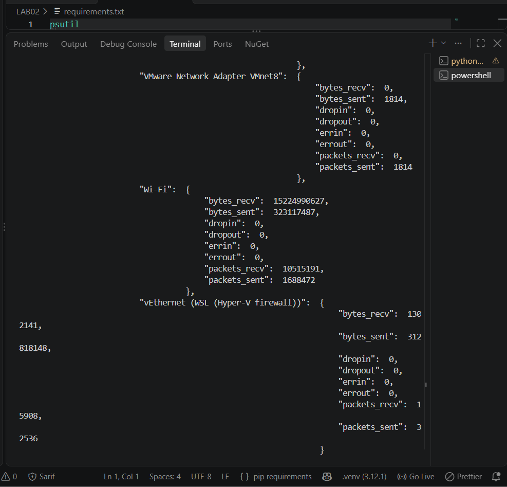

*Hình 9. Kết quả `/api/network` (phần sau, gồm Wi-Fi và vEthernet).*

**d) `GET /api/security`.** Trả về `["os.system", "eval", "exec"]`.

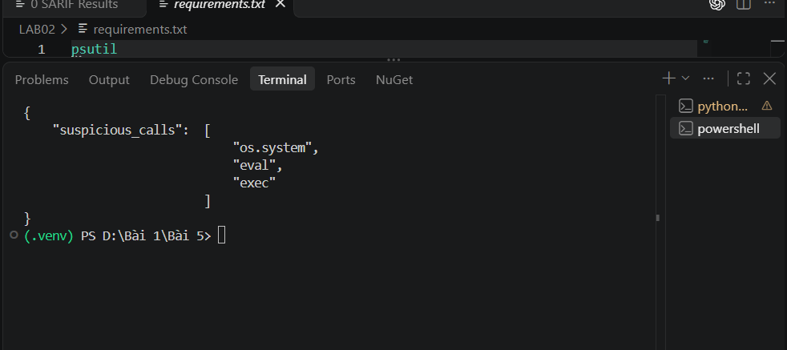

*Hình 10. Kết quả `/api/security`.*

**e) `POST /api/sandbox`.** Lệnh `echo Hello Sandbox` được thực thi trong sandbox, trả về `stdout` là `Hello Sandbox\r\n` (ký tự xuống dòng kiểu Windows) và `stderr` rỗng.

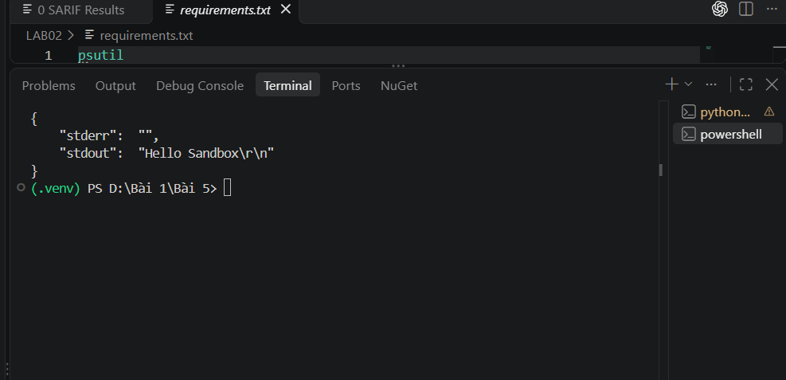

*Hình 11. Kết quả `/api/sandbox`.*

### 8.4. Nhật ký truy cập của máy chủ

Nhật ký của Flask ghi nhận đủ năm yêu cầu, tất cả trả về mã `200`, tương ứng với năm endpoint đã kiểm tra:

| Thời điểm | Yêu cầu | Mã trạng thái |
|---|---|---|
| 20:05:38 | `GET /api/monitor` | 200 |
| 20:06:12 | `GET /api/memory` | 200 |
| 20:06:49 | `GET /api/network` | 200 |
| 20:07:48 | `GET /api/security` | 200 |
| 20:08:17 | `POST /api/sandbox` | 200 |

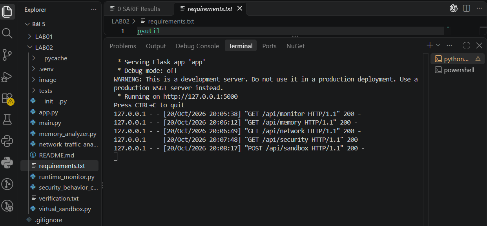

*Hình 12. Nhật ký truy cập của máy chủ Flask.*

## 9. Phân tích và nhận xét

### 9.1. Kết quả đạt được

- Cả năm thành phần hoạt động đúng thiết kế, vượt qua toàn bộ unit test và trả về dữ liệu hợp lệ qua API.
- Các bộ đếm mạng tăng dần giữa hai lần đo (ví dụ `bytes_recv` của Wi-Fi từ 15.224.427.161 ở lần chạy `main.py` lên 15.224.990.627 ở lần gọi API), xác nhận đây là bộ đếm cộng dồn và dữ liệu phản ánh đúng trạng thái thời gian thực.
- Việc tách chức năng thành các lớp độc lập, kèm unit test riêng, giúp dễ mở rộng và kiểm thử từng phần.

### 9.2. Hạn chế và rủi ro bảo mật

| Vấn đề | Phân tích | Hướng cải thiện |
|---|---|---|
| `shell=True` trong `VirtualSandbox` | Lệnh được truyền qua shell nên dễ bị command injection nếu chuỗi lệnh chứa ký tự đặc biệt | Truyền lệnh dạng danh sách, không dùng `shell=True`, kèm danh sách lệnh cho phép |
| Sandbox chưa cô lập thật sự | Chỉ đổi thư mục làm việc; tiến trình con vẫn truy cập được tệp, mạng và tài nguyên của máy chủ | Dùng container (Docker), máy ảo hoặc giới hạn quyền, tài nguyên, thời gian chạy |
| Endpoint `/api/sandbox` thực thi lệnh do client gửi lên | Nếu mở ra ngoài localhost mà không xác thực thì tương đương thực thi mã từ xa (RCE) | Chỉ lắng nghe trên `127.0.0.1`, thêm xác thực và kiểm tra đầu vào |
| `SecurityBehaviorChecker` chỉ tìm chuỗi trong chính tệp của nó | Tệp chứa sẵn các chuỗi `os.system`, `eval`, `exec` trong danh sách luật nên luôn báo cả ba (dương tính giả); không giám sát lời gọi thực tế của tiến trình khác | Phân tích mã mục tiêu bằng AST hoặc theo dõi lời gọi hệ thống (syscall) thực tế |
| `MemoryAnalyzer` chỉ kiểm tra `gc.garbage` | Chỉ phát hiện rò rỉ do chu trình tham chiếu có `__del__`, không phát hiện việc cấp phát tăng liên tục; ngưỡng `2**63` chỉ là mô phỏng vì số nguyên Python không tràn | Theo dõi mức tăng RSS theo thời gian, dùng `tracemalloc` |
| Máy chủ phát triển Flask | Flask cảnh báo không dùng cho môi trường sản xuất | Triển khai bằng máy chủ WSGI như Waitress hoặc Gunicorn |

## 10. Kết luận

Bài thực hành đã xây dựng thành công nền tảng phân tích động gồm `RuntimeMonitor`, `MemoryAnalyzer`, `NetworkTrafficAnalyzer`, `SecurityBehaviorChecker` và `VirtualSandbox`, được kiểm chứng bằng 5 unit test đạt toàn bộ và bằng các lời gọi API trả về mã 200. Kết quả cho thấy kiểm thử động cung cấp thông tin mà phân tích tĩnh không có được, như mức tài nguyên, tệp đang mở, lưu lượng mạng và kết quả thực thi thực tế. Đồng thời, quá trình phân tích mã cũng chỉ ra rằng các thành phần như sandbox và bộ kiểm tra hành vi mới ở mức minh họa; để ứng dụng thực tế cần cô lập mạnh hơn, kiểm soát đầu vào chặt chẽ và cơ chế phát hiện dựa trên hành vi thật của tiến trình.

## 11. Tài liệu tham khảo

1. Tài liệu hướng dẫn thực hành Bài 5: *Phân tích và kiểm thử bảo mật* (SAST và DAST).
2. Tài liệu `psutil`: https://psutil.readthedocs.io
3. Tài liệu Flask: https://flask.palletsprojects.com
4. Tài liệu Python `subprocess`, `tempfile`, `gc`, `unittest`: https://docs.python.org/3/
