# BÁO CÁO THỰC HÀNH BÀI 6: BẢO MẬT VỚI DEVSECOPS

## Mục 6.2 – Thực hành CI/CD

| | |
|---|---|
| **Họ và tên** | Võ Tự Quang Huy |
| **MSSV** | 2387700024 |
| **Lớp** | 23DATA1 |
| **Môn học** | Bảo mật mạng máy tính |
| **Bài thực hành** | Bài 6 – Bảo mật với DevSecOps (mục 6.2) |
| **Ngày thực hiện** | 27–28/10/2026 |
| **Mã nguồn** | https://github.com/Zegening99/test-project và https://github.com/Zegening99/my-pipeline-tutorial-project |
| **Website đã triển khai** | https://zegening99.github.io/my-pipeline-tutorial-project/ |

---

## Mục lục

1. [Mục tiêu](#1-mục-tiêu)
2. [Cơ sở lý thuyết](#2-cơ-sở-lý-thuyết)
3. [Môi trường thực hiện](#3-môi-trường-thực-hiện)
4. [Quá trình thực hiện](#4-quá-trình-thực-hiện)
   - 4.1 [Thử nghiệm trên GitLab và lý do chuyển nền tảng](#41-thử-nghiệm-trên-gitlab-và-lý-do-chuyển-nền-tảng)
   - 4.2 [Bài 6.2.1 – Tạo và chạy pipeline đầu tiên](#42-bài-621--tạo-và-chạy-pipeline-đầu-tiên)
   - 4.3 [Bài 6.2.2 – Pipeline CI/CD phức tạp với Docusaurus](#43-bài-622--pipeline-cicd-phức-tạp-với-docusaurus)
5. [Kết quả và nhận xét](#5-kết-quả-và-nhận-xét)
6. [Đánh giá bảo mật pipeline](#6-đánh-giá-bảo-mật-pipeline)
7. [Hạn chế](#7-hạn-chế)
8. [Kết luận](#8-kết-luận)
9. [Tài liệu tham khảo](#9-tài-liệu-tham-khảo)
10. [Phụ lục: cấu trúc thư mục nộp bài](#10-phụ-lục-cấu-trúc-thư-mục-nộp-bài)

---

## 1. Mục tiêu

Bài thực hành nhằm giúp sinh viên:

1. Hiểu vai trò của CI/CD trong quy trình DevSecOps và các thành phần của một pipeline (job, stage, runner, artifact).
2. Xây dựng pipeline CI/CD cơ bản gồm các giai đoạn `build`, `test`, `deploy`.
3. Xây dựng pipeline thực tế: tự động build một website Docusaurus, lưu sản phẩm build dưới dạng artifact và triển khai lên dịch vụ lưu trữ trang tĩnh.
4. Đối chiếu cách tổ chức pipeline giữa hai nền tảng CI/CD (GitLab CI/CD và GitHub Actions).
5. Nhận diện các điểm cần bảo mật trong pipeline, làm cơ sở để tích hợp các cổng kiểm tra bảo mật (security gates) ở các bước sau.

## 2. Cơ sở lý thuyết

### 2.1. CI/CD

CI/CD là phương pháp phát triển phần mềm liên tục, trong đó mỗi thay đổi mã nguồn được tự động xây dựng, kiểm thử, triển khai và giám sát theo từng vòng lặp. Cách làm này giảm rủi ro do lỗi hoặc do các bản build chưa ổn định (Bài 6, mục 6.2).

### 2.2. Các khái niệm cơ bản của pipeline

| Khái niệm | Ý nghĩa |
|---|---|
| **Pipeline** | Toàn bộ quy trình tự động được định nghĩa trong tệp cấu hình và chạy khi có sự kiện kích hoạt (commit, merge, lịch định kỳ). |
| **Stage (giai đoạn)** | Xác định thứ tự thực hiện, ví dụ `build` → `test` → `deploy`. Các job cùng stage có thể chạy song song. |
| **Job (công việc)** | Tập các lệnh cụ thể được thực hiện trong một stage. |
| **Runner** | Tác nhân (máy vật lý, máy ảo hoặc container) thực thi các job. |
| **Artifact** | Tệp do một job sinh ra và được lưu lại để các job sau sử dụng. |

### 2.3. Thành phần của pipeline an toàn

Theo mục 6.1.1 của tài liệu thực hành, một pipeline an toàn cần có: kiểm soát quyền truy cập (nguyên tắc ít quyền nhất, MFA), quản lý bí mật, ký và kiểm tra mã, các cổng kiểm thử bảo mật tự động (SAST, DAST, SCA, Secret Scanning), giám sát và audit, và bảo vệ CI/CD runner. Việc đưa kiểm thử bảo mật vào sớm trong pipeline được gọi là *Shift Left Security*.

### 2.4. Đối chiếu GitLab CI/CD và GitHub Actions

| GitLab CI/CD | GitHub Actions |
|---|---|
| Tệp `.gitlab-ci.yml` | Tệp trong `.github/workflows/*.yml` |
| `stages:` + `stage:` quyết định thứ tự | `needs:` quyết định thứ tự giữa các job |
| `job` | `job` |
| Runner, `image: node` | `runs-on: ubuntu-latest` + `actions/setup-node` |
| `script:` | `steps:` / `run:` |
| `artifacts:` | `actions/upload-artifact`, `actions/upload-pages-artifact` |
| `$GITLAB_USER_LOGIN` | `${{ github.actor }}` |
| `$CI_COMMIT_BRANCH` | `${{ github.ref_name }}` |
| `environment: production` | `environment: production` |
| GitLab Pages (job `pages`) | GitHub Pages (`actions/deploy-pages`) |
| Build > Pipelines | Tab Actions |

## 3. Môi trường thực hiện

| Thành phần | Chi tiết |
|---|---|
| Hệ điều hành máy cá nhân | Windows, sử dụng Git Bash |
| Công cụ | Git, Node.js (phiên bản 20 trở lên theo yêu cầu của Docusaurus), npm |
| Nền tảng CI/CD | GitHub Actions (runner `ubuntu-latest` do GitHub cung cấp) |
| Nền tảng lưu trữ trang tĩnh | GitHub Pages (nguồn triển khai: GitHub Actions) |
| Ứng dụng mẫu | Website Docusaurus (mẫu `classic`, JavaScript) |
| Tài khoản | `Zegening99` (GitHub) |

## 4. Quá trình thực hiện

### 4.1. Thử nghiệm trên GitLab và lý do chuyển nền tảng

Theo đề bài, bài thực hành được thiết kế cho GitLab CI/CD. Em đã tạo project `test-project` trên GitLab.com (Hình 1) và soạn tệp `.gitlab-ci.yml` gồm 4 job như đề (Hình 2).

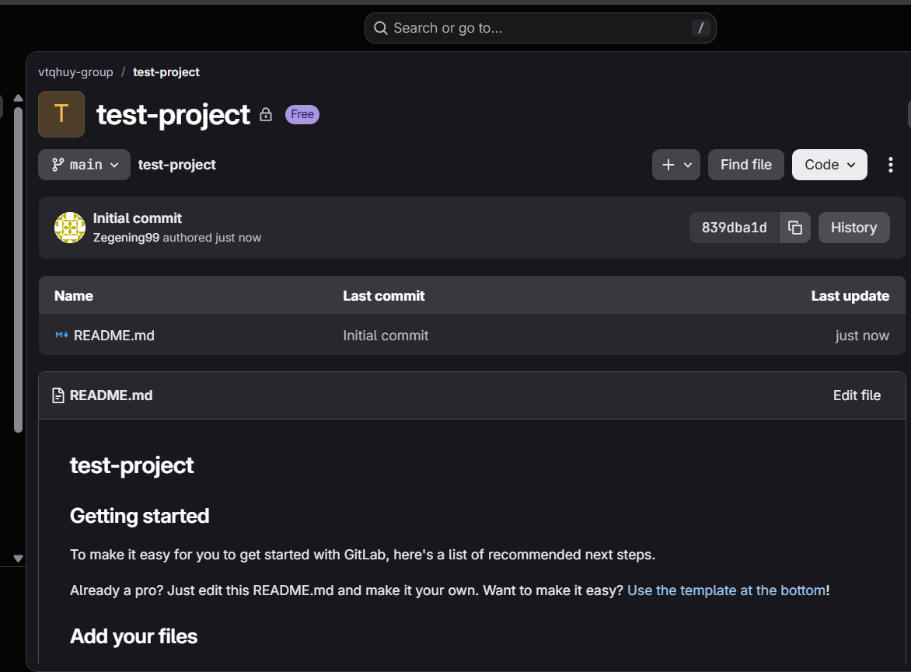

*Hình 1. Project `test-project` được tạo trên GitLab.com.*

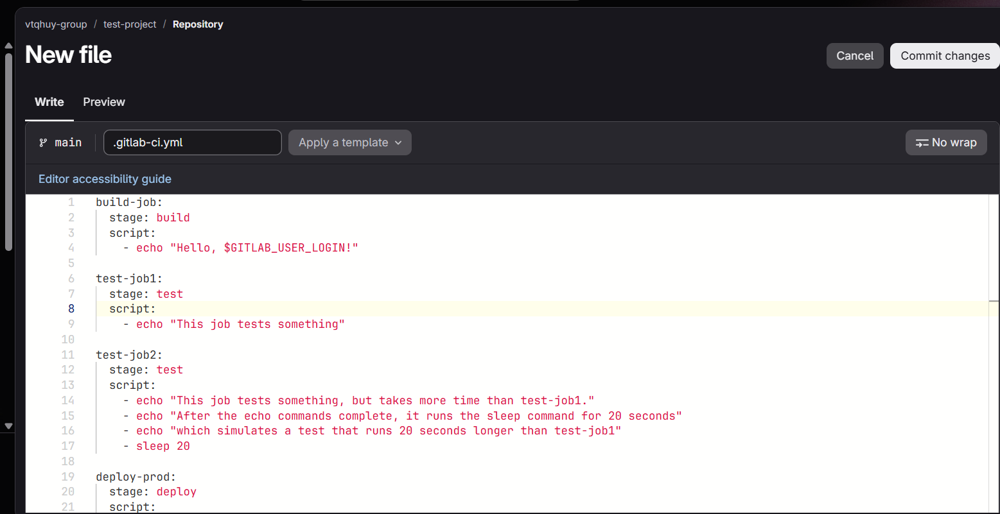

*Hình 2. Soạn tệp `.gitlab-ci.yml` trong trình soạn thảo của GitLab.*

Sau khi commit, pipeline không thể chạy vì GitLab.com yêu cầu xác minh danh tính tài khoản (xác minh bằng điện thoại hoặc thẻ tín dụng) trước khi chạy pipeline. Quá trình xác minh bằng số điện thoại không hoàn tất được và hệ thống chuyển sang yêu cầu thẻ tín dụng. Theo tài liệu của GitLab, việc xác minh phụ thuộc vào mức rủi ro của tài khoản và một số quốc gia chỉ được hỗ trợ một phần đối với xác minh bằng điện thoại.

Do đó, để hoàn thành mục tiêu thực hành là xây dựng và vận hành pipeline CI/CD, em chuyển sang **GitHub Actions**, là nền tảng có mô hình tương đương (bảng đối chiếu ở mục 2.4). Nội dung pipeline được giữ nguyên về cấu trúc: cùng số job, cùng thứ tự thực thi và cùng nội dung lệnh. Tệp `.gitlab-ci.yml` gốc vẫn được lưu trong thư mục `ma-nguon/bai-6.2.1/gitlab-ci.yml` để đối chiếu.

### 4.2. Bài 6.2.1 – Tạo và chạy pipeline đầu tiên

**Mục tiêu:** tạo pipeline gồm 4 job `build-job`, `test-job1`, `test-job2`, `deploy-prod` theo ba giai đoạn build, test, deploy.

**Các bước thực hiện:**

1. Tạo repository công khai `test-project` trên GitHub.
2. Clone repository về máy, tạo thư mục `.github/workflows` và thêm tệp `pipeline.yml`.
3. Commit và push lên nhánh `main`:

```bash
git add .
git commit -m "Add CI pipeline 6.2.1"
git push origin main
```

4. Mở tab **Actions** để theo dõi pipeline.

**Cấu hình pipeline** (`ma-nguon/bai-6.2.1/pipeline.yml`):

```yaml
name: pipeline-co-ban

on:
  push:
    branches: [main]
  workflow_dispatch:

jobs:
  build-job:
    runs-on: ubuntu-latest
    steps:
      - run: echo "Hello, ${{ github.actor }}!"

  test-job1:
    needs: build-job
    runs-on: ubuntu-latest
    steps:
      - run: echo "This job tests something"

  test-job2:
    needs: build-job
    runs-on: ubuntu-latest
    steps:
      - run: |
          echo "This job tests something, but takes more time than test-job1."
          echo "After the echo commands complete, it runs the sleep command for 20 seconds"
          echo "which simulates a test that runs 20 seconds longer than test-job1"
          sleep 20

  deploy-prod:
    needs: [test-job1, test-job2]
    runs-on: ubuntu-latest
    environment: production
    steps:
      - run: echo "This job deploys something from the ${{ github.ref_name }} branch."
```

Trong cấu hình trên, `needs:` thay cho `stages:` của GitLab: `test-job1` và `test-job2` cùng chờ `build-job` nên chạy song song, còn `deploy-prod` chỉ chạy khi cả hai job kiểm thử hoàn thành.

**Kết quả:**

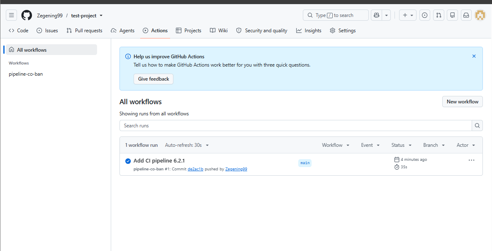

*Hình 3. Danh sách workflow run của `test-project`: run #1 (commit `de2ac1b`) hoàn thành thành công trong 35 giây.*

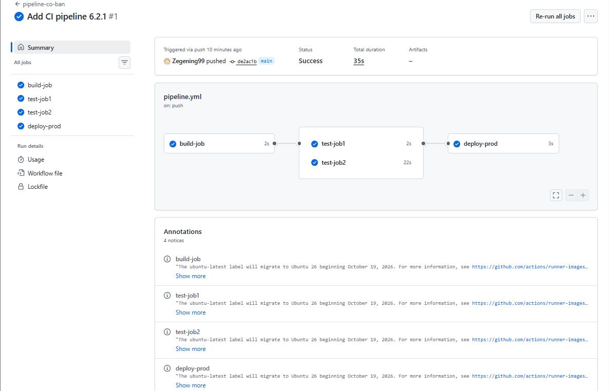

*Hình 4. Sơ đồ pipeline: `build-job` → (`test-job1` ‖ `test-job2`) → `deploy-prod`. Thời gian chạy lần lượt là 2 giây, 2 giây, 22 giây và 3 giây.*

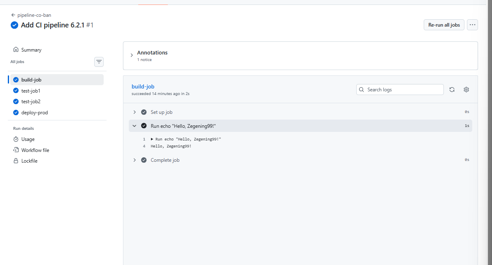

*Hình 5. Log của `build-job`: biến định danh người dùng được thay bằng `Zegening99`, tương ứng với `$GITLAB_USER_LOGIN` của GitLab.*

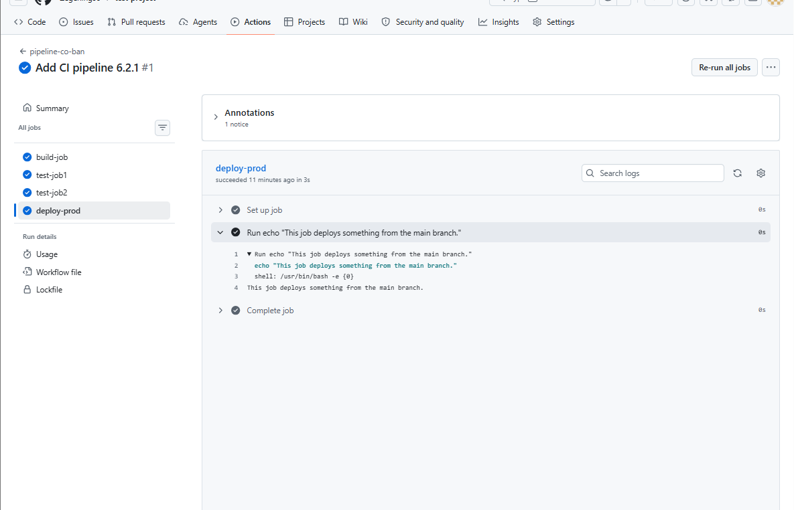

*Hình 6. Log của `deploy-prod`: in ra nhánh đang triển khai là `main`, tương ứng với `$CI_COMMIT_BRANCH` của GitLab.*

**Nhận xét:** `test-job2` có thêm lệnh `sleep 20` nên chạy lâu hơn `test-job1` khoảng 20 giây (22 giây so với 2 giây), đúng như mô tả của đề bài. Hai job cùng giai đoạn chạy song song, và job triển khai chỉ bắt đầu sau khi cả hai hoàn thành.

### 4.3. Bài 6.2.2 – Pipeline CI/CD phức tạp với Docusaurus

**Mục tiêu:** xây dựng pipeline tự động build website Docusaurus, lưu sản phẩm build thành artifact và triển khai lên trang tĩnh.

#### Bước 1. Chuẩn bị mã nguồn

1. Tạo repository công khai `my-pipeline-tutorial-project` (cần công khai để dùng GitHub Pages bản miễn phí).
2. Clone về máy và thêm site Docusaurus (mẫu `classic`).
3. Cập nhật `docusaurus.config.js` cho phù hợp với địa chỉ triển khai:

```js
url: 'https://Zegening99.github.io',
baseUrl: '/my-pipeline-tutorial-project/',
```

4. Commit và push:

```bash
git add .
git commit -m "Add simple generated Docusaurus site"
git push origin main
```

`baseUrl` phải trùng tên repository, nếu sai thì trang web sẽ mất CSS hoặc không tải được tài nguyên.

#### Bước 2. Bật GitHub Pages với nguồn là GitHub Actions

Tại **Settings > Pages > Build and deployment**, đặt **Source** là **GitHub Actions**.

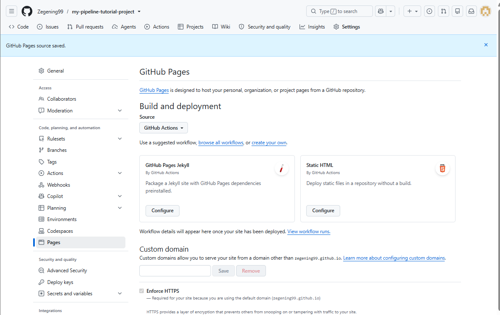

*Hình 7. Cài đặt GitHub Pages với nguồn triển khai là GitHub Actions.*

#### Bước 3. Job đơn giản nhất (`test-job`)

```yaml
jobs:
  test-job:
    runs-on: ubuntu-latest
    steps:
      - run: |
          echo "This is my first job!"
          date
```

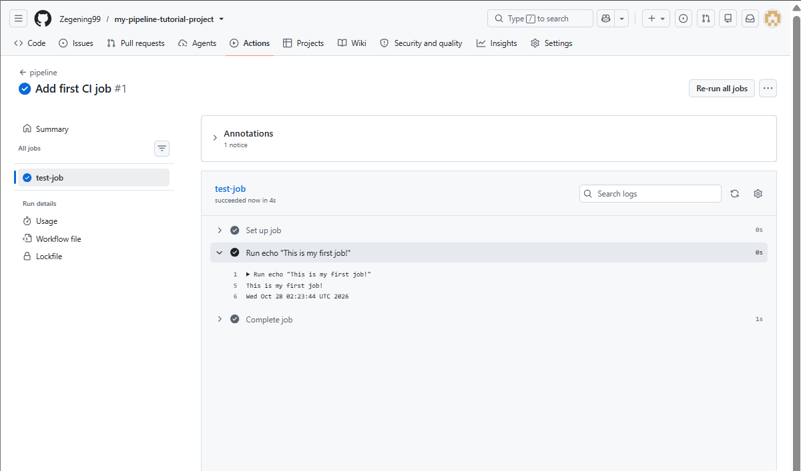

*Hình 8. Log của `test-job` (run #1, commit `92338e7`, 8 giây): thông báo "This is my first job!" và thời gian hệ thống của runner (Wed Oct 28 02:23:44 UTC 2026).*

Bước này xác nhận pipeline đã được kích hoạt và runner thực thi lệnh thành công.

#### Bước 4. Thêm `build-job` và lưu artifact

```yaml
jobs:
  build-job:
    runs-on: ubuntu-latest
    steps:
      - uses: actions/checkout@v4
      - uses: actions/setup-node@v4
        with:
          node-version: 20
      - run: npm install
      - run: npm run build
      - uses: actions/upload-artifact@v4
        with:
          name: build
          path: build/
```

Runner mỗi lần chạy là một máy ảo mới nên phải lần lượt: lấy mã nguồn (`checkout`), cài môi trường Node.js, cài thư viện (`npm install`), build site (`npm run build`) và lưu thư mục `build/` làm artifact để các job sau dùng lại.

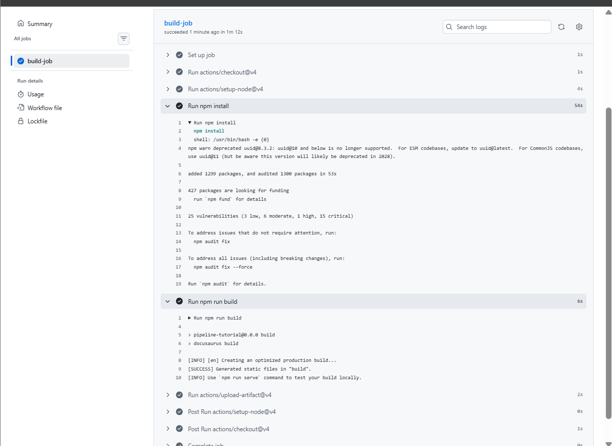

*Hình 9. Log của `build-job` (run #2, commit `ffcd15f`, 1 phút 12 giây). `npm install` cài 1299 gói trong 53 giây; `npm run build` in ra dòng `[SUCCESS] Generated static files in "build"`.*


*Hình 10. Artifact `build` (684 KB) được lưu sau khi job hoàn thành.*

#### Bước 5. Thêm job triển khai (`pages`)

Cấu hình cuối cùng (`ma-nguon/bai-6.2.2/03-final-deploy.yml`):

```yaml
name: pipeline

on:
  push:
    branches: [main]
  workflow_dispatch:

permissions:
  contents: read
  pages: write
  id-token: write

concurrency:
  group: pages
  cancel-in-progress: true

jobs:
  # giai đoạn build
  build-job:
    runs-on: ubuntu-latest
    steps:
      - uses: actions/checkout@v4
      - uses: actions/setup-node@v4
        with:
          node-version: 20
      - run: npm install
      - run: npm run build
      - uses: actions/upload-pages-artifact@v3
        with:
          path: build

  # giai đoạn deploy (chờ build-job hoàn thành)
  pages:
    needs: build-job
    runs-on: ubuntu-latest
    environment:
      name: github-pages
      url: ${{ steps.deployment.outputs.page_url }}
    steps:
      - id: deployment
        uses: actions/deploy-pages@v4
```

Job `pages` có `needs: build-job` nên chỉ chạy khi `build-job` thành công, tương ứng với việc stage `deploy` chờ stage `build` trong GitLab. Artifact được đóng gói bằng `actions/upload-pages-artifact` để `actions/deploy-pages` triển khai lên GitHub Pages.

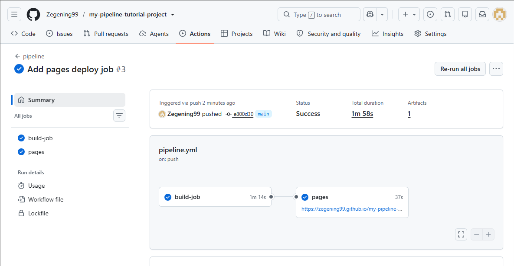

*Hình 11. Run #3 (commit `e800d30`): `build-job` (1 phút 14 giây) → `pages` (37 giây), tổng thời gian 1 phút 58 giây. Job `pages` hiển thị địa chỉ website sau khi triển khai.*

#### Bước 6. Kiểm tra website

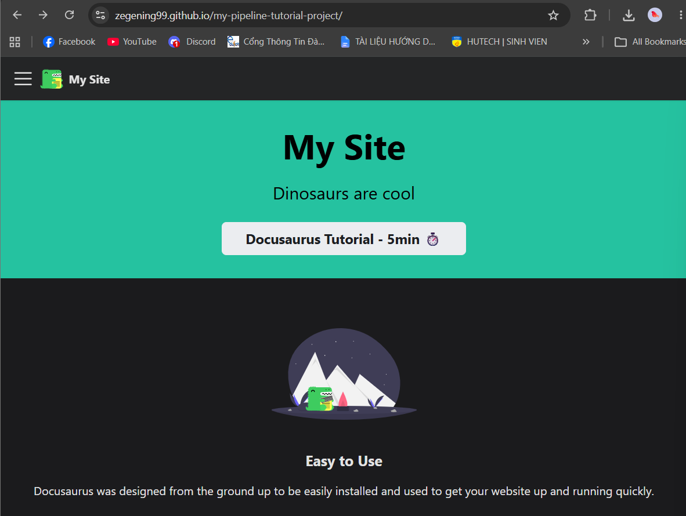

*Hình 12. Website Docusaurus chạy tại `zegening99.github.io/my-pipeline-tutorial-project/`.*

Website truy cập được qua địa chỉ GitHub Pages, hiển thị đúng giao diện và tài nguyên, chứng tỏ `baseUrl` được cấu hình chính xác và pipeline đã triển khai thành công.

## 5. Kết quả và nhận xét

| Hạng mục | Kết quả |
|---|---|
| Pipeline 4 job (bài 6.2.1) | Thành công, 35 giây |
| Job đơn giản `test-job` (bài 6.2.2) | Thành công, 8 giây |
| Job `build-job` + artifact | Thành công, khoảng 1 phút 15 giây, artifact 684 KB |
| Pipeline build → deploy | Thành công, 1 phút 58 giây |
| Website trên GitHub Pages | Truy cập được |

**Nhận xét:**

1. Pipeline được xây dựng tăng dần qua ba commit (`test-job` → `build-job` → `pages`), mỗi bước kiểm chứng được một khái niệm: kích hoạt pipeline, build và lưu artifact, rồi triển khai. Cách làm này giúp khoanh vùng lỗi nhanh nếu có sự cố.
2. Thời gian chạy dài nhất ở bước `npm install` (khoảng 53 giây). Có thể rút ngắn bằng cách bật bộ nhớ đệm phụ thuộc (`cache: npm` của `actions/setup-node`).
3. Mỗi job chạy trên một runner mới, không chia sẻ trạng thái với job khác. Vì vậy dữ liệu truyền giữa các job bắt buộc phải qua artifact, đúng với mô tả trong tài liệu.
4. Thứ tự thực thi được kiểm soát bằng `needs:`; điều này tương đương với `stages:` trong GitLab nhưng linh hoạt hơn vì có thể mô tả phụ thuộc theo từng job.

## 6. Đánh giá bảo mật pipeline

Phần này đối chiếu pipeline đã xây dựng với các thành phần của pipeline an toàn ở mục 2.3.

| Tiêu chí | Hiện trạng | Nhận xét / đề xuất |
|---|---|---|
| Quyền truy cập (ít quyền nhất) | Workflow khai báo khối `permissions` chỉ gồm `contents: read`, `pages: write`, `id-token: write` | Phù hợp nguyên tắc ít quyền nhất, không dùng quyền ghi toàn repository |
| Quản lý bí mật | Pipeline hiện không dùng khóa API hay mật khẩu | Khi cần, phải lưu trong GitHub Secrets, không viết trực tiếp vào mã nguồn |
| Cách ly runner | Dùng runner do GitHub cung cấp, mỗi job chạy trên một máy ảo riêng | Giảm nguy cơ lây nhiễm giữa các lần chạy |
| Phiên bản action | Dùng thẻ phiên bản (`@v4`, `@v3`) | Nên cố định theo mã băm commit (SHA) để giảm rủi ro chuỗi cung ứng |
| Phiên bản runner | Dùng nhãn `ubuntu-latest`. GitHub có cảnh báo (annotation) về việc nhãn này sẽ chuyển sang Ubuntu 26 (Hình 4) | Nên cố định phiên bản cụ thể (ví dụ `ubuntu-24.04`) để pipeline ổn định |
| Quét lỗ hổng phụ thuộc (SCA) | Chưa có | Log `npm install` (Hình 9) báo 25 lỗ hổng (3 thấp, 6 trung bình, 1 cao, 15 nghiêm trọng) trong cây phụ thuộc |
| Phân tích mã tĩnh (SAST), quét bí mật | Chưa có | Có thể bổ sung CodeQL và công cụ quét bí mật |
| Giám sát và audit | Mọi lần chạy được ghi log chi tiết trong tab Actions | Đáp ứng yêu cầu ghi log; chưa có cảnh báo hành vi bất thường |

**Quan sát đáng chú ý.** Kết quả `npm install` cho thấy ngay cả một dự án mẫu cũng có nhiều lỗ hổng trong các thư viện phụ thuộc. Đây là ví dụ cho lý do cần một cổng SCA bắt buộc trong pipeline (mục 6.1.2). Một đề xuất cấu hình có thể thêm vào trước bước build, chưa được triển khai trong bài này:

```yaml
      - run: npm audit --audit-level=high
```

Lệnh này làm job thất bại nếu phát hiện lỗ hổng mức cao trở lên, từ đó chặn việc triển khai khi chưa xử lý. Với dự án mẫu hiện tại, bước này sẽ báo lỗi vì có lỗ hổng mức cao và nghiêm trọng, nên cần cân nhắc cập nhật thư viện hoặc đặt ngưỡng phù hợp trước khi bật làm cổng bắt buộc.

## 7. Hạn chế

1. Bài thực hành được hoàn thành trên GitHub Actions thay vì GitLab CI/CD do không xác minh được tài khoản GitLab. Cú pháp cấu hình khác nhau giữa hai nền tảng, nhưng khái niệm và luồng thực thi tương đương như bảng ở mục 2.4.
2. Chưa tích hợp các cổng kiểm thử bảo mật (SAST, SCA, Secret Scanning); mục 6 chỉ đưa ra đánh giá và đề xuất.
3. Phạm vi bài chỉ gồm build và triển khai một website tĩnh, chưa bao gồm kiểm thử đơn vị hay quét container, hạ tầng dưới dạng mã (IaC).

## 8. Kết luận

Qua bài thực hành, em đã:

- Xây dựng thành công pipeline CI/CD 4 job theo ba giai đoạn build, test, deploy và quan sát được việc các job kiểm thử chạy song song.
- Triển khai pipeline build website Docusaurus, lưu artifact và tự động đưa lên GitHub Pages; website truy cập được công khai.
- Nắm được cách tổ chức pipeline ở hai nền tảng và đối chiếu được các khái niệm tương ứng (stage/`needs`, runner, artifact, environment, Pages).
- Nhận diện được các điểm cần củng cố về bảo mật, đặc biệt là việc bổ sung cổng quét phụ thuộc, cố định phiên bản action/runner và quản lý bí mật, làm cơ sở để áp dụng các biện pháp DevSecOps ở mục 6.1.


## 9. Phụ lục: cấu trúc thư mục nộp bài

```
bao-cao-lab06/
├── README.md                          # báo cáo này
├── images/                            # 12 hình minh họa
│   ├── hinh-01-gitlab-tao-project.png
│   ├── hinh-02-gitlab-soan-gitlab-ci.png
│   ├── hinh-03-actions-danh-sach-run-6.2.1.png
│   ├── hinh-04-so-do-pipeline-6.2.1.png
│   ├── hinh-05-log-build-job-6.2.1.png
│   ├── hinh-06-log-deploy-prod-6.2.1.png
│   ├── hinh-07-cai-dat-github-pages.png
│   ├── hinh-08-log-test-job-6.2.2.png
│   ├── hinh-09-log-build-job-6.2.2.png
│   ├── hinh-10-artifact-build.png
│   ├── hinh-11-so-do-build-pages.png
│   └── hinh-12-website-github-pages.png
└── ma-nguon/
    ├── bai-6.2.1/
    │   ├── gitlab-ci.yml              # cấu hình gốc theo đề (GitLab)
    │   └── pipeline.yml               # cấu hình đã chạy (GitHub Actions)
    └── bai-6.2.2/
        ├── 01-test-job.yml
        ├── 02-build-job.yml
        └── 03-final-deploy.yml
```
